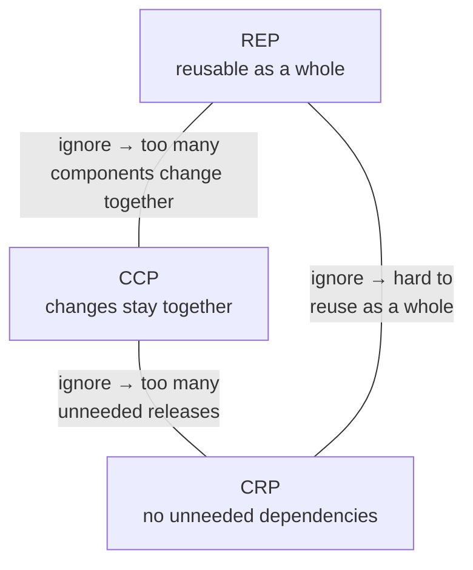
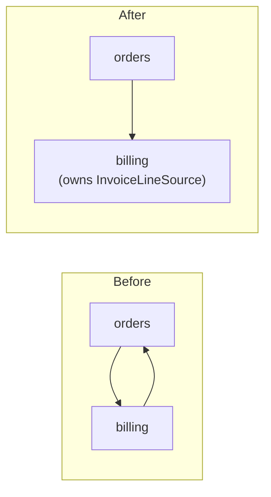
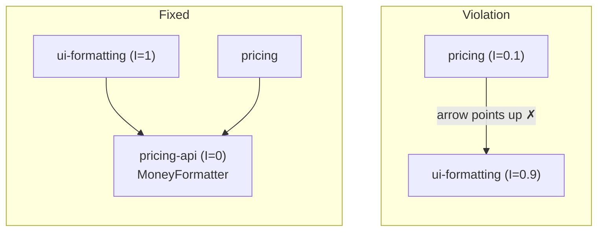
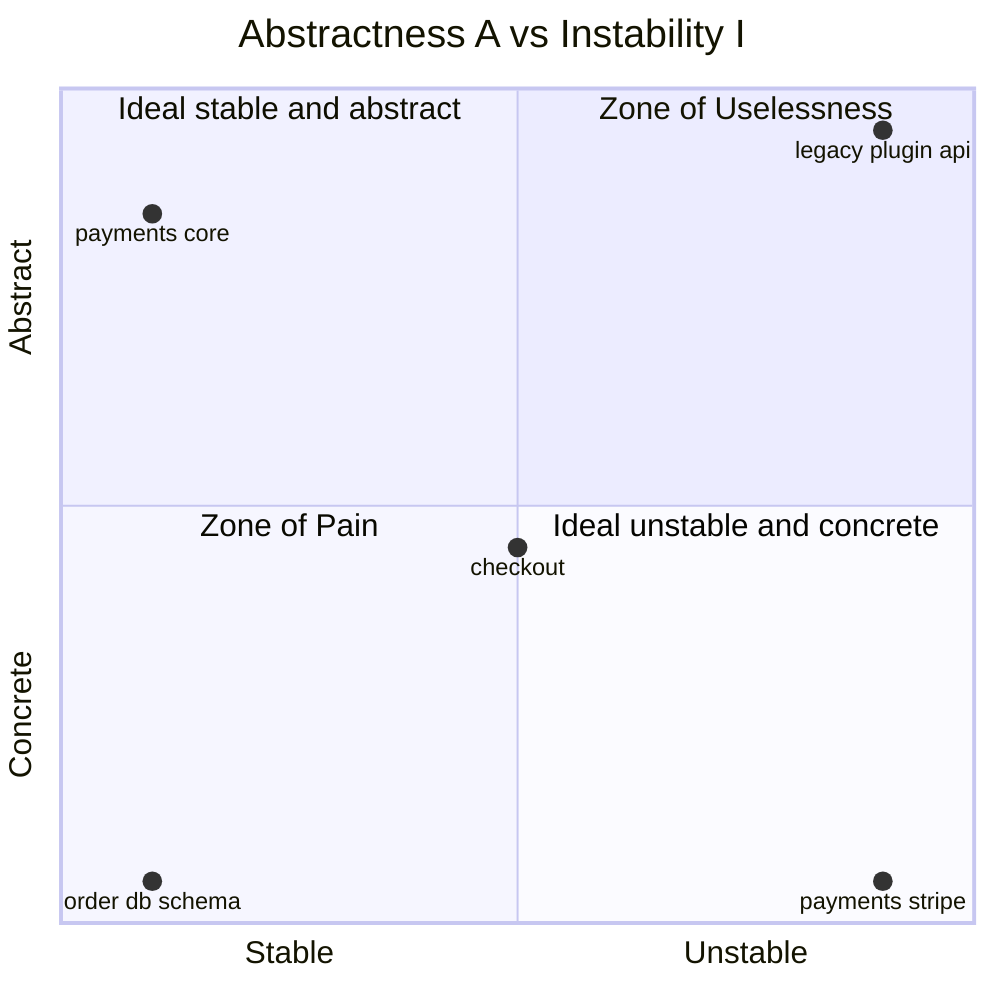

# Component principles

Chapters 12–14: what goes in a component (cohesion) and how components may depend on each other (coupling, with metrics).

## Contents

- [Components](#components)
- [REP: Reuse/Release Equivalence Principle](#rep-reuserelease-equivalence-principle)
- [CCP: Common Closure Principle](#ccp-common-closure-principle)
- [CRP: Common Reuse Principle](#crp-common-reuse-principle)
- [Component Cohesion: The Tension Diagram](#component-cohesion-the-tension-diagram)
- [ADP: Acyclic Dependencies Principle](#adp-acyclic-dependencies-principle)
- [SDP: Stable Dependencies Principle](#sdp-stable-dependencies-principle)
- [SAP: Stable Abstractions Principle](#sap-stable-abstractions-principle)
- [The Main Sequence](#the-main-sequence)

## Components

> Components are the units of deployment. They are the smallest entities that can be deployed as part of a system.

*Chapter 12.*

### What it means in practice

A component is whatever unit a language/platform actually ships: a jar in Java, a gem in Ruby, a DLL in .NET, an npm package in JS — "in all languages, they are the granule of deployment." The chapter's real point is historical: programs used to be written at fixed memory addresses with no way to combine separately-compiled pieces; relocatable binaries and linking loaders made it possible to compile modules independently and link them later; and as linking got fast enough (1990s), dynamically-loaded plugin components (jars, DLLs, shared libraries) became the casual default they are today — you `import`/`require` a component without a second thought.

The practical takeaway: well-designed components stay **independently deployable and therefore independently developable** — a team can change and ship one component without forcing every other component to rebuild and redeploy with it. That property is what the three cohesion principles (REP, CCP, CRP) and the coupling principles exist to protect.

### Related

- REP: Reuse/Release Equivalence Principle
- CCP: Common Closure Principle
- CRP: Common Reuse Principle
- Component Cohesion: The Tension Diagram
- ADP: Acyclic Dependencies Principle
- SDP: Stable Dependencies Principle
- SAP: Stable Abstractions Principle
- The Main Sequence
- Decoupling Modes and Boundary Anatomy (`drawing-boundaries.md`) — deployment-level decoupling is this note's "unit of deployment" in action.
- Packaging Strategies: Layer, Feature, Ports & Adapters, Component (`packaging.md`) — Simon Brown's competing definition of "component".

## REP: Reuse/Release Equivalence Principle

> The granule of reuse is the granule of release.

*Chapter 13.*

### What it means in practice

Nobody can safely reuse software that isn't versioned and released — without release numbers, a changelog, and some release discipline (think Maven, npm), a consumer has no way to decide when to take an update or know what changed. Since the thing that gets *released* is a component, and the thing that gets *reused* is also a component, the two units are necessarily the same — which means a component can't just be an arbitrary bag of classes. It needs a real, cohesive theme, because everything in it ships together, versions together, and gets adopted together by whoever depends on it.

### Example: why "utils" is a bad component

A `utils` package that mixes date formatting, HTTP retry logic, and PDF generation gets released as one version. A consumer who only wants the date formatting still has to adopt (and re-test against) whatever changed in the PDF generation code this release — because REP means the reuse granule *is* the release granule, whether or not the classes inside are actually related. Splitting it into `date-utils`, `http-retry`, and `pdf-export` components lets each one version and release independently of the others.

### Related

- CCP: Common Closure Principle
- CRP: Common Reuse Principle
- Component Cohesion: The Tension Diagram
- ADP: Acyclic Dependencies Principle — releasing components independently only works if the dependency graph has no cycles.
- Frameworks Are Details (`details.md`) — "usable before reusable": a reusable framework has to be grown alongside several real consumers.

## CCP: Common Closure Principle

> Gather into components those classes that change for the same reasons and at the same times. Separate into different components those classes that change at different times and for different reasons.

*Chapter 13.*

### What it means in practice

CCP is SRP (`solid.md`) restated one level up, for components instead of classes: "a component should not have multiple reasons to change." Since 100% closure against every possible change is unattainable (OCP (`solid.md`)), the pragmatic move is to close a component against the kinds of change actually expected, by co-locating the classes that tend to change together for the same reason. When a requirement changes, the goal is that the change is confined to as few components as possible, so only those need re-testing and redeploying — "for most applications, maintainability is more important than reusability."

### Example: co-locating what changes together

If checkout's tax-calculation rules and its receipt-formatting rules both change whenever a new market/region launches, they belong in the same component (say, `checkout-region-rules`) — even though "tax" and "receipts" sound like different concerns. A regional launch then means testing and redeploying one component, not hunting across three unrelated ones for every place regional logic leaked into.

### Related

- SRP: Single Responsibility Principle (`solid.md`)
- REP: Reuse/Release Equivalence Principle
- CRP: Common Reuse Principle
- Component Cohesion: The Tension Diagram
- ADP: Acyclic Dependencies Principle — CCP shapes the components; ADP keeps the graph between them acyclic as it evolves.
- SDP: Stable Dependencies Principle — CCP creates components meant to be volatile; SDP protects them from being frozen.
- Decoupling Layers and Use Cases (`drawing-boundaries.md`)
- Policy and Level (`drawing-boundaries.md`) — policies that change for the same reasons are at the same level.

## CRP: Common Reuse Principle

> Don't force users of a component to depend on things they don't need.

*Chapter 13.*

### What it means in practice

"The CRP is the generic version of ISP (`solid.md`): ISP says don't depend on classes with methods you don't use, CRP says don't depend on components with classes you don't use." Any dependency on a component forces a rebuild/redeploy/revalidation whenever *anything* in that component changes — even a class the dependent never touches. So classes that are genuinely used together (a container and its iterator, say) belong in the same component; classes that aren't tightly bound shouldn't be bundled together just because they seem thematically similar.

### Example: don't bundle what isn't used together

A `checkout` component that bundles `PaymentGateway`, `PaymentGatewayFactory`, and an unrelated `TaxReportExporter` forces every consumer of payments to also pull in tax-report code — and to redeploy whenever the tax exporter changes, even though they never call it. Splitting `TaxReportExporter` into its own component means the payment-only consumers stop depending on something they never needed.

### Related

- ISP: Interface Segregation Principle (`solid.md`)
- REP: Reuse/Release Equivalence Principle
- CCP: Common Closure Principle
- Component Cohesion: The Tension Diagram
- SAP: Stable Abstractions Principle

## Component Cohesion: The Tension Diagram

> Projects tend to start on the right hand side of the triangle, where the only sacrifice is reuse. As the project matures, and other projects begin to draw from it, the project will slide over to the left.

*Chapter 13.*

### What it means in practice

REP and CCP are *inclusive* principles — both push components to grow bigger (bundle more in for reuse, bundle more in so changes stay together). CRP is *exclusive* — it pushes components smaller (don't bundle in what a consumer doesn't need). Pulling toward all three at once is impossible; the book draws them as a triangle where each edge represents the cost of ignoring the principle at the opposite vertex.

There's no fixed optimum — where a project should sit on the triangle shifts as it matures. Early on, develop-ability matters more than reuse, so CCP dominates and REP gets sacrificed. As other teams start depending on the component, REP and CRP start to matter more, and the component has to migrate toward being genuinely reusable and minimal, not just convenient to change.



### Example: watching a component slide across the triangle

A `notifications` component starts life optimized for CCP — email, SMS, and push logic all bundled together because they change together during early development. Once a second product starts depending on it, REP becomes unavoidable: it needs real releases and versioning. Eventually a third consumer only wants SMS and complains about pulling in push-notification dependencies it never uses — CRP forces a split. None of the three principles was "wrong" at any point; the component just moved across the triangle as its context changed.

### Related

- REP: Reuse/Release Equivalence Principle
- CCP: Common Closure Principle
- CRP: Common Reuse Principle
- Components
- ADP: Acyclic Dependencies Principle — the coupling-side counterpart: cohesion decides what goes in a component, coupling decides how components relate.

## ADP: Acyclic Dependencies Principle

> Allow no cycles in the component dependency graph.

*Chapter 14.*

### What it means in practice

Splitting a system into separately released Components only works if the dependency graph between them is a DAG. With no cycles, each team works against the *released* versions of what it depends on, the impact of a release is found by following arrows backward, and the whole system builds bottom-up in an obvious order. A single cycle fuses every component on it into one big de-facto component: they must all be released, built, and tested together, and you're back to the "morning after syndrome" (your code broke overnight because someone changed something you depend on).

A cycle can always be broken, in one of two ways:

1. **Apply DIP (`solid.md`)** — put an interface in the component that needs the call, and have the other component implement it.
2. **Extract a new component** that both depend on, and move the shared classes into it.

The second option is why component structure "jitters": it can't be designed top-down on day one. Component diagrams aren't a map of the system's *functions* — they're a map of its *buildability and maintainability*, so they grow and get reshaped as the code (and its volatility) appears.

### Example: breaking an `orders` ↔ `billing` cycle

`orders` calls `billing` to charge a customer; later someone makes `billing` call back into `orders` to look up an order's line items for the invoice. Now neither can be tested or released without the other.

```java
// Before: billing → orders (cycle, since orders → billing already exists)
public class InvoiceBuilder {
    private final OrderRepository orders;          // class from the `orders` component
}

// After (DIP): billing owns the interface it needs; orders implements it
package billing;
public interface InvoiceLineSource {
    List<InvoiceLine> linesFor(String orderId);
}

package orders;
public class OrderInvoiceLines implements billing.InvoiceLineSource { ... }
```



### Related

- SDP: Stable Dependencies Principle
- SAP: Stable Abstractions Principle
- Components
- CCP: Common Closure Principle — CCP shapes components as the graph evolves; ADP keeps the result buildable.
- DIP: Dependency Inversion Principle (`solid.md`) — the first of the two ways to break a cycle.

## SDP: Stable Dependencies Principle

> Depend in the direction of stability.

*Chapter 14.*

### What it means in practice

"Stable" here doesn't mean "rarely changes" — it means **hard to change**, and the surest way to make a component hard to change is to have lots of other components depend on it. A component designed to be volatile (easy to change) gets frozen the moment someone hangs a dependency on it from a component that is hard to change. SDP says: never let that happen — dependencies should point from the volatile toward the stable.

Martin quantifies it with the **instability** metric:

| Metric | Meaning |
|---|---|
| **Fan-in** | classes *outside* the component that depend on classes inside it |
| **Fan-out** | classes *inside* the component that depend on classes outside it |
| **I = Fan-out / (Fan-in + Fan-out)** | 0 = maximally stable (responsible, independent); 1 = maximally unstable (irresponsible, dependent) |

SDP restated with the metric: **I should decrease in the direction of dependency.** Draw unstable components at the top and stable ones at the bottom, and any arrow pointing *up* is a violation. Not every component should be stable — a system where everything had I = 0 couldn't change at all.

When a stable component needs something from a volatile one, the fix is DIP (`solid.md`): extract an interface into its own *abstract component* (I = 0, contains only interfaces), have both sides depend on it, and the volatile component keeps its I = 1. Abstract components exist mainly in statically typed languages; in dynamic languages the inversion needs no declared interface.

### Example: a stable core leaning on a volatile UI helper

`pricing` (I ≈ 0.1, depended on by checkout, cart, invoicing, and reports) starts importing `ui-formatting` to reuse its `formatMoney()`. `ui-formatting` is supposed to change with every redesign (I ≈ 0.9), but now every tweak to it forces `pricing` and all its dependents to be rebuilt and re-tested. Fix: move a `MoneyFormatter` interface into a tiny abstract component `pricing-api`; `ui-formatting` implements it, `pricing` depends only on the interface.



### Related

- ADP: Acyclic Dependencies Principle
- SAP: Stable Abstractions Principle — SDP + SAP together are DIP for components.
- The Main Sequence
- CCP: Common Closure Principle — CCP is what *creates* components meant to be volatile; SDP protects them.
- DIP: Dependency Inversion Principle (`solid.md`)

## SAP: Stable Abstractions Principle

> A component should be as abstract as it is stable.

*Chapter 14.*

### What it means in practice

High-level policy belongs in stable components (I = 0) — but stable means hard to change, which would make the architecture rigid. The way out is OCP (`solid.md`): if the stable component is made of interfaces and abstract classes, it can be *extended* without being *modified*. So SAP pairs stability with abstraction: stable components should be abstract (extensible despite being hard to change), unstable components should be concrete (their instability is what makes their concrete code cheap to change).

Combined with SDP — dependencies run toward stability, and stability implies abstraction — you get **dependencies run toward abstraction**, which is DIP (`solid.md`) for components. The difference is that a class is either abstract or not, while a component can be *partially* abstract and *partially* stable.

Abstractness is measured as **A = Na / Nc** (abstract classes + interfaces ÷ total classes). A = 0 means fully concrete, A = 1 means nothing but abstractions. How A and I should relate is the Main Sequence.

### Example: a `payments` core that stays stable *and* extensible

```java
// payments-core: depended on by checkout, subscriptions, refunds → I ≈ 0
// Mostly abstractions → A high
public interface PaymentGateway { ChargeResult charge(Money amount, PaymentMethod method); }
public interface FraudCheck     { RiskScore assess(Charge charge); }
public abstract class RetryPolicy { public abstract Duration nextDelay(int attempt); }

// payments-stripe: nobody depends on it → I ≈ 1, fully concrete → A = 0
public class StripeGateway implements PaymentGateway { ... }
```

Adding Adyen means writing `payments-adyen` against the same interfaces; `payments-core` never changes even though half the system depends on it.

### Related

- SDP: Stable Dependencies Principle
- The Main Sequence
- ADP: Acyclic Dependencies Principle
- OCP: Open-Closed Principle (`solid.md`) — the reason a stable component can still be flexible.
- DIP: Dependency Inversion Principle (`solid.md`)

## The Main Sequence

> A component that sits on the Main Sequence is not "too abstract" for its stability, nor is it "too unstable" for its abstractness.

*Chapter 14.*

### What it means in practice

Plot every component on a graph with instability **I** (SDP) on the x-axis and abstractness **A** (SAP) on the y-axis. The two ideal corners are (I=0, A=1) — stable and fully abstract — and (I=1, A=0) — unstable and fully concrete. The line joining them is the **Main Sequence**; components should sit on or near it. Two regions are to be avoided:

- **Zone of Pain (≈ 0, 0)** — stable *and* concrete: heavily depended on, but impossible to extend, so every change hurts. Classic resident: a database schema. Only *volatile* things here are painful; a non-volatile concrete utility like a `String` library sits there harmlessly.
- **Zone of Uselessness (≈ 1, 1)** — fully abstract with no dependents: leftover interfaces nobody implements or uses.

The distance metric **D = |A + I − 1|** (0 = on the line, 1 = as far as possible) turns this into something you can track: flag components whose D isn't near 0, look at mean/variance across the system for outliers, or plot one component's D release over release to spot dependencies creeping in. Martin is explicit that it's a heuristic: "a metric is not a god."



### Example: reading a real dependency report

Running a dependency-analysis tool over an e-commerce monorepo: `payments-core` (I=0.1, A=0.85, D=0.05) and `payments-stripe` (I=0.9, A=0.05, D=0.05) are fine. `order-db-schema` (I=0.1, A=0.05, D=0.85) is in the Zone of Pain — which is exactly why every migration ripples through half the codebase; the fix is to stop letting other components depend on table shapes directly (put a repository interface in front). `legacy-plugin-api` (I=0.9, A=0.95) is in the Zone of Uselessness — interfaces nobody implements anymore; delete them.

### Related

- SDP: Stable Dependencies Principle
- SAP: Stable Abstractions Principle
- ADP: Acyclic Dependencies Principle
- Components
- The Database Is a Detail (`details.md`) — why a schema everybody depends on ends up in the Zone of Pain.
