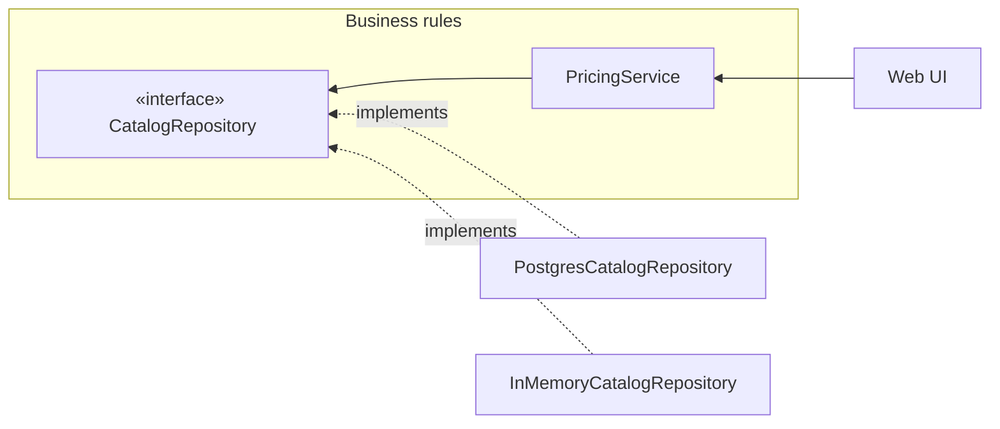

# Drawing boundaries

Chapters 15–19, 24–25: policy vs. details, where boundaries go, decoupling modes from monolith to services, and how much boundary to pay for.

## Contents

- [Keep Options Open: Policy vs. Details](#keep-options-open-policy-vs-details)
- [Policy and Level](#policy-and-level)
- [Decoupling Layers and Use Cases](#decoupling-layers-and-use-cases)
- [Architectural Boundaries and the Plugin Architecture](#architectural-boundaries-and-the-plugin-architecture)
- [Decoupling Modes and Boundary Anatomy](#decoupling-modes-and-boundary-anatomy)
- [Partial Boundaries](#partial-boundaries)
- [Anticipating Boundaries: When to Pay for One](#anticipating-boundaries-when-to-pay-for-one)

## Keep Options Open: Policy vs. Details

> The strategy behind that facilitation is to leave as many options open as possible, for as long as possible.

*Chapter 15.*

### What it means in practice

Architecture is the *shape* of a system — its division into components, their arrangement, and how they communicate — and that shape exists to make the system easy to **develop, deploy, operate, and maintain**, not to make it work (plenty of terribly structured systems work fine). Martin weighs the four goals unequally: operational problems can usually be bought off with hardware, while development and maintenance (the "spelunking" through code plus the risk of breaking something) cost people, which is the expensive resource. A good architecture also makes operation *visible*: use cases are first-class, obvious elements of the code.

Every system splits into **policy** (business rules — where the value lives) and **details** (database, web server, framework, protocols, DI container, IO devices). The architect's job is to make the policy ignorant of the details, so those decisions can be postponed until there's real information to make them with — or made, swapped, and experimented with cheaply later. If the company already "decided" on a database or framework, a good architect pretends it hasn't and keeps the code shaped so it could still change. "A good architect maximizes the number of decisions not made."

Martin also insists that architects keep programming: they can't guide a design if they don't feel the problems it causes.

### Example: shipping the checkout rules before picking the stack

A team building a marketplace writes `PlaceOrder`, pricing, and stock-reservation logic against an `OrderRepository` interface and plain request/response objects. For the first two months orders live in an in-memory map and the "UI" is a test suite. When load numbers finally come in, they pick Postgres (not the MongoDB the original plan assumed) and REST over GraphQL — and neither choice touches the business rules. Martin's historical analogues: device-independent IO in the 1960s (programs written against an abstract "unit record" device ran unchanged on cards or tape), and replacing hard-wired cylinder/head/sector disk addresses with relative addresses.

### Related

- Design vs. Architecture (`paradigms-and-values.md`)
- Two Values of Software: Behavior vs. Architecture (`paradigms-and-values.md`) — structure is the more valuable of the two because it keeps software soft; keeping options open is how.
- Architectural Boundaries and the Plugin Architecture — the mechanism that makes deferral possible.
- Decoupling Layers and Use Cases
- The Dependency Rule (`layers-and-dependency-rule.md`)
- OCP: Open-Closed Principle (`solid.md`) — device independence was OCP before it had a name.
- The Database Is a Detail (`details.md`)
- The Web Is a Detail (`details.md`)
- Frameworks Are Details (`details.md`)

## Policy and Level

> A strict definition of "level" is "the distance from the inputs and outputs."

*Chapter 19.*

### What it means in practice

A program is a statement of **policy** for turning inputs into outputs, made of many smaller policies (how to compute X, how to format report Y, how to validate input Z). Policies that change for the same reasons at the same times are at the same **level** and belong in the same component; the components form a DAG whose edges are source-code dependencies (`import`/`using`/`require`).

**Level = distance from inputs and outputs.** The policies that read input and write output are the lowest level; the policy farthest from both is the highest. Higher-level policies change less often and for weightier reasons; lower-level ones change often, urgently, and for trivial reasons. So source-code dependencies must point **toward the higher level** — which means they're *decoupled from data flow* (data flows in from the input, through the core, out to the output; dependencies all point inward to the core). Lower-level components are plugins to higher-level ones.

The chapter is a convergence point: SRP and CCP group policies by level, OCP and DIP point the arrows, SDP and SAP make the high-level component stable and abstract.

### Example: a CSV import job

Wrong: high-level policy calls IO directly, so it depends on it.

```java
void importCustomers() {
    for (String line : Files.readAllLines(path))          // input detail
        db.insert(normalize(parse(line)));                  // output detail
}
```

Right: the import policy owns the interfaces it reads from and writes to; CSV and Postgres are plugins.

```java
public interface CustomerSource { Iterable<RawCustomer> read(); }
public interface CustomerSink   { void store(Customer c); }

public class CustomerImport {                // highest level: farthest from IO
    public void run(CustomerSource in, CustomerSink out) {
        for (RawCustomer raw : in.read()) out.store(Customer.normalize(raw));
    }
}

class CsvCustomerSource implements CustomerSource { ... }      // low level (input)
class PostgresCustomerSink implements CustomerSink { ... }     // low level (output)
```

Next quarter the input becomes an S3 JSON feed and the output a CRM API — two new low-level plugins; `CustomerImport` doesn't change.

### Related

- Architectural Boundaries and the Plugin Architecture
- The Dependency Rule (`layers-and-dependency-rule.md`) — "point toward higher-level policy", generalized to the concentric circles.
- Critical Business Rules (Entities) (`layers-and-dependency-rule.md`) — the highest-level policy of all.
- SRP: Single Responsibility Principle (`solid.md`)
- CCP: Common Closure Principle (`component-principles.md`)
- DIP: Dependency Inversion Principle (`solid.md`)
- SDP: Stable Dependencies Principle (`component-principles.md`)
- SAP: Stable Abstractions Principle (`component-principles.md`)
- Structured Programming (`paradigms-and-values.md`) — Page-Jones's "central transform" comes from the structured-design tradition.

## Decoupling Layers and Use Cases

> If you decouple the elements of the system that change for different reasons, then you can continue to add new use cases without interfering with old ones.

*Chapters 16, 33.*

### What it means in practice

Even without knowing every use case, the architect knows the system's intent, and can apply SRP (`solid.md`) and CCP (`component-principles.md`) along two axes at once:

- **Horizontal layers** — things that change for different reasons and at different rates: UI, application-specific business rules, application-independent (domain) business rules, database. Field validation is tied to the app; interest calculation is tied to the domain — they change for different reasons, so they go in different layers.
- **Vertical slices** — the use cases themselves. "Add order" changes for different reasons than "cancel order", so each use case keeps its own UI piece, its own rules, and its own data access, cutting down through the layers.

Getting both right pays off on all four architectural goals: use cases are visible, slices with different throughput needs are already separable for **operation**, teams can work on different slices or layers without colliding (whatever Conway's law dictates about team shape), and slices can be **deployed** independently — in the limit, adding a use case means dropping in a new jar or service. *How* far apart the pieces are pushed is a separate choice: the decoupling mode.

The Video Sales case study (Chapter 33) shows the two axes as the two dimensions of a component diagram: **actors** (SRP — who asks for changes) split the system vertically, and the Dependency Rule (`layers-and-dependency-rule.md`) (policy level — how often things change) splits it horizontally. Once code is partitioned that way, how components are bundled into deployables (one jar per layer, per actor, or just two jars) is a reversible decision.

#### Conway's law

> Any organization that designs a system will produce a design whose structure is a copy of the organization's communication structure.

### Example: an order-management system

```
orders/
  place-order/       PlaceOrderController · PlaceOrderInteractor · PlaceOrderGateway
  cancel-order/      CancelOrderController · CancelOrderInteractor · CancelOrderGateway
  track-shipment/    ...
domain/              Order · Money · TaxPolicy           ← application-independent rules
```

Each folder is a vertical slice with its own controller/interactor/gateway (the horizontal layers inside it). The `cancel-order` team can rewrite its screens and queries without touching `place-order`, and if `track-shipment` turns out to need 50× the traffic, it's already a separable unit. The slices only share what is *truly* the same — the domain model — and nothing that is merely accidentally similar (`layers-and-dependency-rule.md`).

### Related

- Keep Options Open: Policy vs. Details
- Decoupling Modes and Boundary Anatomy
- True vs. Accidental Duplication (`layers-and-dependency-rule.md`)
- SRP: Single Responsibility Principle (`solid.md`) — actors are SRP's "reasons to change", applied at system scale.
- CCP: Common Closure Principle (`component-principles.md`)
- Screaming Architecture (`packaging.md`) — vertical use-case slices are what make the architecture "scream" the domain.
- Application Business Rules (Use Cases) (`layers-and-dependency-rule.md`)
- Packaging Strategies: Layer, Feature, Ports & Adapters, Component (`packaging.md`) — package by layer vs. by feature is the code-organization version of these two axes.

## Architectural Boundaries and the Plugin Architecture

> Software architecture is the art of drawing lines that I call boundaries.

*Chapter 17.*

### What it means in practice

What drains the people-power a system costs is coupling — especially coupling to **premature decisions**: framework, database, web server, DI container, three-tier topology, SOA tooling. None of those are business requirements. Boundaries are the lines that keep those decisions out of the core so they can be deferred.

**Where to draw them:** between things that matter and things that don't — more precisely, wherever there's an **axis of change** (two sides changing at different rates for different reasons). That's SRP (`solid.md`) telling you where boundaries go. The GUI doesn't matter to the business rules; the database doesn't matter to the business rules; the IO in general is irrelevant to the model behind it.

**How to draw them:** put an interface owned by the business rules on the line, implement it on the far side, so the arrow crosses the boundary *toward* the core. The database component knows about the business rules (it contains the translation into SQL); the business rules don't know the database exists. That's DIP (`solid.md`) plus SAP (`component-principles.md`).

Do this for the UI, the database, and everything else, and you have a **plugin architecture**: a core of business rules with replaceable plugins around it. The relationship is deliberately asymmetric — like ReSharper and Visual Studio: the plugin team can't hurt the host, the host can break the plugin. The boundary becomes a firewall: changes in the GUI or the schema can't propagate into the business rules.

### Example: deferring the database for real

Martin's FitNesse story: all page storage went behind a `WikiPage` interface. For months it was a stub, then an in-memory hash map, then flat files — and MySQL was never needed (a customer later wrote a MySQL implementation in a day). The same move in a typical product:

```java
// Owned by the core
public interface CatalogRepository {
    Optional<Product> findBySku(String sku);
    void save(Product product);
}

// Plugins, chosen at startup
class InMemoryCatalogRepository implements CatalogRepository { ... }   // dev & tests
class PostgresCatalogRepository  implements CatalogRepository { ... }   // production
```



Every arrow crossing the boundary points into the core. The cautionary counter-examples are company P (a three-tier, every-object-serialized-three-times design that only ever ran on one server) and company W (enterprise SOA for a small fleet-management shop).

### Related

- Keep Options Open: Policy vs. Details
- The Dependency Rule (`layers-and-dependency-rule.md`) — the general rule this chapter's arrows obey.
- Decoupling Modes and Boundary Anatomy — the physical forms a boundary can take.
- Partial Boundaries
- Anticipating Boundaries: When to Pay for One
- Policy and Level
- SRP: Single Responsibility Principle (`solid.md`) — tells you *where* to draw the line.
- DIP: Dependency Inversion Principle (`solid.md`) — tells you *which way* the arrow points.
- The Main Component (`layers-and-dependency-rule.md`) — the outermost plugin.

## Decoupling Modes and Boundary Anatomy

> A good architecture will allow a system to be born as a monolith, deployed in a single file, but then to grow into a set of independently deployable units, and then all the way to independent services and/or micro-services.

*Chapters 16, 18.*

### What it means in practice

At runtime, crossing a boundary is just a function on one side calling a function on the other and passing data. What makes it a boundary is **source-code dependency management**: the lower-level side depends on the higher-level side, never the reverse. The physical form the boundary takes — the decoupling mode — is a separate decision, and one worth leaving open:

| Mode / physical form | What it is | Communication cost |
|---|---|---|
| **Source level** — monolith | One executable, one address space; separation is pure discipline + polymorphism | Function calls — can be very chatty |
| **Deployment level** — jars, DLLs, gems, shared libs | Independently deployable binaries, usually still one process | Function calls (plus a one-time load) — still chatty |
| **Local processes** | Separate address spaces on the same machine; sockets, queues, shared memory | OS calls, marshalling, context switches — limit chattiness |
| **Services** | Processes that assume all communication goes over the network | Milliseconds to seconds — avoid chattiness |

(Threads aren't a boundary at all — they're a way of scheduling execution, inside or across components.)

The same rule applies in every mode: higher-level code must not know the lower-level side's names, addresses, registry keys, or URIs — lower levels plug into higher ones. Real systems mix modes (a service is often a facade over local processes, each of which is a monolith of source-level components).

Martin's preference: decouple **to the point where a service *could* be formed**, but keep components in one address space for as long as possible. Defaulting to services is expensive in dev time and system resources, and tends to produce *coarse* decoupling anyway. Move a component up the ladder (source → deployment → service) only when development, deployment, or operational pressure demands it — and be able to move it back down when that pressure goes away.

### Example: a notifications module climbing the ladder

1. **Source level:** `notifications` is a package inside the monolith; `OrderPlaced` handlers call a `Notifier` interface owned by the order module.
2. **Deployment level:** it becomes its own jar so the growth team can release email-template changes without a full rebuild.
3. **Service level:** Black Friday push volume forces it out to its own service behind a queue. Because callers only ever knew the `Notifier` interface, the change is one new `QueueNotifier` adapter plus deployment config — no business code moves.

### Related

- Decoupling Layers and Use Cases — *what* to separate; this note is *how far apart*.
- Architectural Boundaries and the Plugin Architecture
- Keep Options Open: Policy vs. Details
- Services Are Not an Architecture (`details.md`) — the service mode is just one physical form, not an architecture.
- Components (`component-principles.md`) — deployment-level decoupling is exactly the "component = unit of deployment" definition.
- Object-Oriented Programming (`paradigms-and-values.md`) — dynamic polymorphism is what makes source- and deployment-level boundaries safe.
- DIP: Dependency Inversion Principle (`solid.md`)

## Partial Boundaries

> It is one of the functions of an architect to decide where an architectural boundary might one day exist, and whether to fully or partially implement that boundary.

*Chapter 24.*

### What it means in practice

A full architectural boundary is expensive: reciprocal polymorphic boundary interfaces, input/output data structures, and separately compiled and deployed components — all of which have to be maintained. When a boundary *might* be needed but YAGNI says not yet, a partial boundary holds its place more cheaply. Three options, from most to least protective:

| Strategy | What you build | What you skip | How it degrades |
|---|---|---|---|
| **Skip the last step** | Everything a full boundary needs (interfaces, DTOs, separation) | Separate deployment/versioning — it ships as one component | Once nobody believes it'll be split, dependencies start crossing the wrong way (FitNesse's web server vs. wiki) |
| **One-dimensional boundary** (Strategy) | One interface the client uses and the service implements | The reciprocal interface for the reverse direction | Nothing but discipline stops a back-channel from the implementation to the client |
| **Facade** (Facade) | A single class listing the services and delegating to them | Even dependency inversion | Client transitively depends on every service class (recompiles on change); back-channels are trivial |

Each is a legitimate placeholder; each also rots if the full boundary never materializes.

### Example: a reporting module that might become a separate product

Sales wants "maybe sell analytics standalone next year".

- **Skip the last step:** build `analytics` with its own input/output boundary interfaces and DTOs, in its own module of the repo, but ship it inside the main app's artifact. Splitting it later is a build-config change — if the team keeps the discipline.
- **One-dimensional:** the app depends only on an `AnalyticsService` interface; `DefaultAnalyticsService` implements it. Cheap, but nothing stops `DefaultAnalyticsService` from reaching back into `OrderController`.
- **Facade:** an `Analytics` class with `revenueByMonth()`, `topProducts()` that forwards to internal classes. Cheapest, and the weakest isolation.

### Related

- Anticipating Boundaries: When to Pay for One — the judgment call of *which* boundaries deserve full, partial, or no implementation.
- Architectural Boundaries and the Plugin Architecture
- DIP: Dependency Inversion Principle (`solid.md`)

## Anticipating Boundaries: When to Pay for One

> Your goal is to implement the boundaries right at the inflection point where the cost of implementing becomes less than the cost of ignoring.

*Chapter 25 and Appendix A.*

### What it means in practice

"UI, business rules, database" is a convenient lie: Martin takes a 200-line text adventure and finds a boundary along every axis of change — human language, delivery channel (console, SMS, chat), storage (flash, cloud, RAM), network for multiplayer, and even a split *inside* the game rules between low-level movement mechanics and higher-level player-health policy (which becomes a full boundary the moment it moves to a server). Each axis produces its own data stream through the components, all meeting at the highest-level policy. Boundaries exist everywhere.

That leaves a real dilemma. Fully implemented boundaries are expensive; YAGNI rightly warns that over-engineering is often worse than under-engineering. But a boundary you ignored is very expensive to retrofit, even with good tests. There's no formula — the architect has to guess intelligently, decide for each potential boundary whether to implement it fully, partially, or not at all, and **keep watching**: note where a boundary could go, wait for the first friction from its absence, then re-weigh the cost, and revisit the decision regularly.

The Appendix gives the cautionary tale for the other side: a CASE tool built with layer upon layer of communication overhead and an intrusive OO database was scrapped after years for a small desktop app written by a tiny team. "Architecture must be flexible enough to adapt to the size of the problem."

### Example: notifications in a growing SaaS

- **Year 1:** emails go out via a `Mailer` interface — a one-dimensional boundary, because email provider changes are plausible but cheap to absorb.
- **Year 2:** product adds SMS and push. Friction shows up: every feature that notifies now has `if (user.prefersSms)` branches. That's the inflection point → introduce a full `notifications` boundary with a `NotificationRequest` DTO and channel plugins.
- **Not done:** splitting `notifications` into its own service. It's been considered and deliberately ignored until throughput or team ownership actually forces it.

### Related

- Partial Boundaries
- Architectural Boundaries and the Plugin Architecture
- Decoupling Modes and Boundary Anatomy
- Keep Options Open: Policy vs. Details
- Policy and Level — the meeting point of the streams is the highest-level policy.
- Services Are Not an Architecture (`details.md`)
