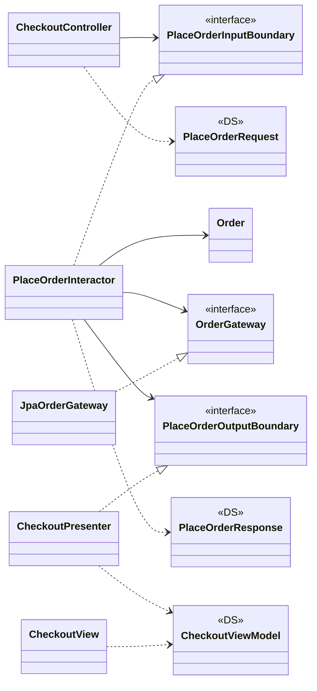

# Layers and the Dependency Rule

Chapters 16, 20, 22–23, 26: the circles, the Dependency Rule, entities vs. use cases, what crosses a boundary, Humble Object, and Main as composition root.

## Contents

- [The Clean Architecture (the Circles)](#the-clean-architecture-the-circles)
- [The Dependency Rule](#the-dependency-rule)
- [Critical Business Rules (Entities)](#critical-business-rules-entities)
- [Application Business Rules (Use Cases)](#application-business-rules-use-cases)
- [Humble Object](#humble-object)
- [The Main Component](#the-main-component)
- [True vs. Accidental Duplication](#true-vs-accidental-duplication)

## The Clean Architecture (the Circles)

> By separating the software into layers and conforming to the Dependency Rule, you will create a system that is intrinsically testable, with all the benefits that implies.

*Chapter 22.*

### What it means in practice

Hexagonal Architecture / Ports and Adapters (Cockburn), DCI (Coplien & Reenskaug), and BCE (Jacobson) all share one goal — separation of concerns, with at least one layer for business rules and one for interfaces — and the same payoff: a system independent of frameworks, UI, database, and any external agency, and testable without any of them. The Clean Architecture is Martin's unification of them into concentric circles, outer = mechanisms, inner = policies, held together by the Dependency Rule:

| Circle (inner → outer) | Contains |
|---|---|
| **Entities** | Enterprise-wide Critical Business Rules |
| **Use cases** | Application-specific rules; orchestrate entities; isolated from DB/UI/frameworks |
| **Interface adapters** | Controllers, presenters, views (all of MVC lives here), gateways; convert data between use-case format and external format. All SQL lives here. |
| **Frameworks & drivers** | Web framework, database, devices — mostly glue code. "The web is a detail. The database is a detail." |

Four circles is schematic, not a rule — what's fixed is that dependencies point inward and abstraction increases inward.

**Crossing boundaries.** In the canonical flow, control goes Controller → Use case → Presenter, but every source dependency points at the use case: the controller calls an *input boundary* interface; the interactor calls an *output boundary* interface the presenter implements.

### Example: a web checkout request, end to end



1. The web framework hands form data to `CheckoutController`, which builds a plain `PlaceOrderRequest` and calls `PlaceOrderInputBoundary`.
2. `PlaceOrderInteractor` loads data through `OrderGateway` (implemented by `JpaOrderGateway` out in the adapters ring), drives the `Order` entity, and builds a plain `PlaceOrderResponse` (may contain `Money`, `LocalDate`).
3. It passes the response to `PlaceOrderOutputBoundary`, implemented by `CheckoutPresenter`, which formats everything into a `CheckoutViewModel` of strings and flags ("$1,240.00", `placeOrderButtonEnabled=false`).
4. `CheckoutView` just copies the view model into HTML.

Swap Spring for Ktor, JPA for jOOQ, or the web page for a mobile API: only the outer two rings change.

### Related

- The Dependency Rule
- Critical Business Rules (Entities)
- Application Business Rules (Use Cases)
- Humble Object — presenters/views and gateways/ORMs are Humble Object splits.
- The Main Component — wires the circles together from the very outside.
- Architectural Boundaries and the Plugin Architecture (`drawing-boundaries.md`)
- Packaging Strategies: Layer, Feature, Ports & Adapters, Component (`packaging.md`) — ports and adapters as a code-organization style.
- Screaming Architecture (`packaging.md`)
- The Test Boundary (`details.md`)

## The Dependency Rule

> Source code dependencies must point only inward, toward higher-level policies.

*Chapter 22.*

### What it means in practice

Nothing in an inner circle may know anything about an outer circle: no class, function, or variable *name* declared outside may be mentioned inside, and no *data format* declared outside (especially framework-generated ones) may be used inside. It's the one non-negotiable rule of the Clean Architecture — the number of circles can vary, this rule can't.

Flow of control often has to go outward (a use case needs to call a presenter or a repository). The rule is preserved by DIP (`solid.md`): the inner circle declares an interface (an "output port"), the outer circle implements it, so the source-code dependency points inward even though control flows out.

What crosses a boundary must be **simple, isolated data structures** in the form most convenient for the *inner* circle — DTOs, plain records, function arguments, even a map. Never pass Entity objects outward, and never pass database rows or framework request objects inward.

### Example: the three classic violations, and the fix

```java
// ✗ inner circle names an outer one
public class PlaceOrderInteractor {
    private final JdbcTemplate jdbc;                    // database detail inside a use case
}

// ✗ outer data format leaks in
public void execute(HttpServletRequest request) { ... } // web detail inside a use case

// ✗ inner object leaks out
return order;                                           // Entity handed to the view/JSON serializer

// ✓ inward-pointing dependencies, plain data across the line
public class PlaceOrderInteractor implements PlaceOrderInputBoundary {
    private final OrderGateway orders;                  // interface declared in this circle
    private final PlaceOrderOutputBoundary presenter;   // interface declared in this circle
    public void execute(PlaceOrderRequest req) { ... }  // plain record
}
```

### Related

- The Clean Architecture (the Circles)
- DIP: Dependency Inversion Principle (`solid.md`) — the mechanism that makes the rule possible when control flows outward.
- Architectural Boundaries and the Plugin Architecture (`drawing-boundaries.md`)
- Policy and Level (`drawing-boundaries.md`)
- SDP: Stable Dependencies Principle (`component-principles.md`) — the component-level ancestor: depend toward stability.
- ADP: Acyclic Dependencies Principle (`component-principles.md`) — a graph that only points inward can't have cycles.
- Object-Oriented Programming (`paradigms-and-values.md`) — polymorphism is what lets source dependencies oppose the flow of control.
- Humble Object
- The Test Boundary (`details.md`) — tests obey the rule too: they're the outermost circle.

## Critical Business Rules (Entities)

> An Entity is an object within our computer system that embodies a small set of critical business rules operating on Critical Business Data.

*Chapters 20, 22.*

### What it means in practice

**Critical Business Rules** are the rules that make or save the business money *even if nobody automated them* — a clerk with a calculator would apply them too. They operate on **Critical Business Data** (data that would exist without the system). The rules and their data are inseparable, so they're bundled into one module: an **Entity** (Ivar Jacobson's term). It doesn't have to be a class — any module that binds the data and the rules together works.

An Entity is "pure business and nothing else": no database annotations, no HTTP types, no framework base classes. In the Clean Architecture it's the innermost circle — the most general, highest-level policy, the least likely to change when something external changes, and potentially shared by many applications in an enterprise. Entities know nothing about the use cases that drive them.

Note this is not the same as a DDD entity (an object with identity) or a JPA `@Entity` (a mapped table row) — Martin's Entity is defined by *what rules it carries*, not by identity or persistence.

### Example: a loan and a subscription

```java
// Rules a bank would apply on paper, too
public class Loan {
    private final Money principal;
    private final Rate annualRate;
    private final Period term;

    public Money monthlyPayment() { ... }
    public Money interestFor(YearMonth month) { ... }
    public Loan applyExtraPayment(Money amount) { ... }
}

// Same idea in a SaaS product: proration exists whether or not there's software
public class Subscription {
    private final Plan plan;
    private final LocalDate periodStart, periodEnd;

    public Money prorationFor(Plan newPlan, LocalDate switchDate) { ... }
}
```

Neither class imports anything from Spring, JPA, Stripe, or the web layer.

### Related

- Application Business Rules (Use Cases) — the next ring out: rules that only exist because the system is automated.
- The Clean Architecture (the Circles)
- The Dependency Rule
- Policy and Level (`drawing-boundaries.md`) — Entities are the highest-level policy: farthest from any input or output.
- SAP: Stable Abstractions Principle (`component-principles.md`)

## Application Business Rules (Use Cases)

> Use cases contain the rules that specify how and when the Critical Business Rules within the Entities are invoked. Use cases control the dance of the Entities.

*Chapters 20, 22.*

### What it means in practice

Some business rules only make sense *because* the system is automated: "don't show a payment estimate until contact details are verified and the credit score is ≥ 500." These are **application-specific business rules**, captured as **use cases**: the input the user provides, the processing steps, and the output returned. A use case orchestrates Entities but says nothing about *how* data gets in or out — you can't tell from it whether the app is web, desktop, CLI, or a pure service.

In code, a use case is an object (an **interactor**) with functions implementing those rules, holding the input data, output data, and references to the Entities it drives. Dependencies point from use cases to Entities, never the reverse: Entities are general and reusable across applications, use cases are specific to one, so they're closer to the IO and therefore lower level.

**Request and response models.** The interactor takes a plain request data structure and returns a plain response data structure — no `HttpServletRequest`, no ORM rows, no framework types, or the use case inherits those dependencies. And don't let them hold references to Entities even when the fields overlap: they change for different reasons, so tying them together violates SRP and CCP (it's accidental duplication).

### Example: placing an order

```java
public record PlaceOrderRequest(String customerId, List<LineItem> items, String couponCode) {}
public record PlaceOrderResponse(String orderId, String total, LocalDate estimatedDelivery) {}

public class PlaceOrderInteractor implements PlaceOrderInputBoundary {
    private final CustomerGateway customers;     // interfaces owned by this layer
    private final OrderGateway orders;
    private final PlaceOrderOutputBoundary presenter;

    public void execute(PlaceOrderRequest req) {
        Customer customer = customers.byId(req.customerId());
        if (!customer.canPlaceOrders())                            // app rule
            { presenter.rejected("Account suspended"); return; }
        Order order = Order.create(customer, req.items());          // entity rules
        order.applyCoupon(req.couponCode());
        orders.save(order);
        presenter.present(new PlaceOrderResponse(order.id(), order.total().toString(), order.eta()));
    }
}
```

Nothing here mentions HTTP, JSON, SQL, or which UI called it.

### Related

- Critical Business Rules (Entities)
- The Clean Architecture (the Circles)
- The Dependency Rule
- Humble Object — presenters and gateways are the humble objects on either side of the interactor.
- Screaming Architecture (`packaging.md`) — use cases are what the top-level structure should reveal.
- Decoupling Layers and Use Cases (`drawing-boundaries.md`)
- True vs. Accidental Duplication
- SRP: Single Responsibility Principle (`solid.md`)
- CCP: Common Closure Principle (`component-principles.md`)

## Humble Object

> At each architectural boundary, we are likely to find the Humble Object pattern lurking somewhere nearby.

*Chapter 23 (pattern originally from Meszaros, *xUnit Test Patterns*).*

### What it means in practice

Split a behavior that's hard to test into two parts: a **humble** object that keeps only the hard-to-test bit, stripped down to almost nothing, and a testable object that holds everything else. Because that split usually falls exactly where an architectural boundary runs, the pattern doubles as a way to *find* and *protect* boundaries — and it's everywhere in the Clean Architecture:

| Boundary | Testable side | Humble side |
|---|---|---|
| UI | **Presenter** — formats dates, money, labels, enabled/disabled and color flags into a **View Model** of strings, booleans, enums | **View** — copies the View Model onto the screen, no logic |
| Database | **Interactor** — app rules; testable because gateways can be stubbed | **Gateway implementation** — just runs the SQL for methods like `lastNamesOfUsersLoggedInAfter(date)` |
| ORM | — | **Data mapper** (ORM) — lives in the database layer, between gateway interfaces and the DB |
| Services | Application code passes plain data structures | **Service listeners / senders** — translate to/from the wire format |

Martin's aside on ORMs: there's no such thing as an "object-relational mapper", because objects aren't data structures (from the outside they're just operations). ORMs are *data mappers* — they load tables into data structures — and they belong in the outer database layer.

### Example: an invoice screen

```java
// Testable: every decision about what appears on screen
public class InvoicePresenter implements ShowInvoiceOutputBoundary {
    private InvoiceViewModel vm;
    public void present(ShowInvoiceResponse r) {
        vm = new InvoiceViewModel(
            "Invoice #" + r.number(),
            DateTimeFormatter.ofPattern("MMM d, yyyy").format(r.dueDate()),
            r.balance().format(Locale.US),               // "$1,240.00"
            r.balance().isNegative(),                     // showBalanceInRed
            !r.isPaid()                                   // payButtonEnabled
        );
    }
}

// Humble: no branching, no formatting — just binding
public class InvoiceView {
    void render(InvoiceViewModel vm) {
        title.setText(vm.title()); due.setText(vm.dueDate());
        balance.setText(vm.balance()); balance.setRed(vm.showBalanceInRed());
        payButton.setEnabled(vm.payButtonEnabled());
    }
}
```

The presenter gets fast unit tests (`present(overdueInvoice)` → assert the strings and flags); the view is too dumb to need them.

### Related

- The Clean Architecture (the Circles)
- Application Business Rules (Use Cases) — the interactor in the middle of the presenter/gateway humble objects.
- The Dependency Rule
- The Test Boundary (`details.md`) — testability as an architectural force.
- Architectural Boundaries and the Plugin Architecture (`drawing-boundaries.md`)

## The Main Component

> Think of Main as the dirtiest of all the dirty components.

*Chapter 26.*

### What it means in practice

Every system has at least one component that creates, coordinates, and oversees the others: **Main**. It's the ultimate detail — the lowest-level policy, the entry point, depended on by nothing except the OS. Its job is to build all the factories, strategies, configuration, and global facilities, then hand control to the high-level abstract parts of the system. It's the one place allowed to name every concrete class, which is how the rest of the code gets to obey DIP (`solid.md`) (the DIP note's "push every violation into one place").

If you use a DI framework, this is where it belongs: inject into Main, then have Main pass dependencies along normally — the framework doesn't leak inward.

Because Main is a plugin sitting behind a boundary, you can have **many Mains**: one per environment (dev/test/prod), per country, per customer. Configuration stops being a problem the core has to know about.

### Example: two Mains for the same core

```java
// Production composition root
public class ProdMain {
    public static void main(String[] args) {
        var config  = Config.fromEnv();
        var db      = new PostgresOrderGateway(DataSources.pooled(config.dbUrl()));
        var payment = new StripeGateway(config.stripeKey());
        var useCase = new PlaceOrderInteractor(db, payment, new EmailReceiptSender(config.smtp()));
        new HttpServer(config.port(), new CheckoutController(useCase)).start();
    }
}

// Local/demo composition root: same core, all fakes
public class DemoMain {
    public static void main(String[] args) {
        var useCase = new PlaceOrderInteractor(
            new InMemoryOrderGateway(), new AlwaysApprovesPayments(), new ConsoleReceiptSender());
        new HttpServer(8080, new CheckoutController(useCase)).start();
    }
}
```

`PlaceOrderInteractor` has no idea which Main built it.

### Related

- DIP: Dependency Inversion Principle (`solid.md`) — Main is where the Abstract Factory concretions and every `new` of a volatile class end up.
- The Clean Architecture (the Circles) — Main lives in the outermost circle.
- Architectural Boundaries and the Plugin Architecture (`drawing-boundaries.md`) — Main is just another plugin.
- Frameworks Are Details (`details.md`) — the DI framework is allowed to know about Main and nothing deeper.
- Keep Options Open: Policy vs. Details (`drawing-boundaries.md`)

## True vs. Accidental Duplication

> If two apparently duplicated sections of code evolve along different paths—if they change at different rates, and for different reasons—then they are not true duplicates.

*Chapter 16.*

### What it means in practice

**True duplication** is when every change to one copy must be made to every other copy — that's the Duplicated Code smell, and it should be removed. **Accidental duplication** is when two pieces of code look the same *today* but serve different actors or layers; they'll drift apart, and unifying them couples things that should change independently. Before extracting the shared code, ask "will these always change together, for the same reason?" — if not, leave the duplicate.

Two places this bites architects specifically:

- **Across use cases (vertical):** two screens or two queries look alike, so they get merged — then one use case's change breaks the other.
- **Across layers (horizontal):** a database row has the same fields as what the screen shows, so the row object gets passed straight up to the UI. Writing a separate view model is cheap; skipping it couples the UI to the schema.

### Example: two "identical" order summaries

```java
// Customer-facing order summary and warehouse pick-list happen to show the same fields today
record OrderSummaryView(String orderId, List<String> items, String shipTo) {}   // customer UI
record PickListView(String orderId, List<String> items, String shipTo) {}       // warehouse UI
```

The tempting refactor is one shared `OrderView`. But the customer view will soon add prices, promo badges, and estimated delivery; the pick list will add bin locations and package weight. Different actors (customers vs. warehouse ops), different reasons to change — the duplication is accidental, so keep two types.

### Related

- SRP: Single Responsibility Principle (`solid.md`) — the test for "true vs. accidental" is the SRP question: same actor, same reason to change?
- Decoupling Layers and Use Cases (`drawing-boundaries.md`)
- Application Business Rules (Use Cases) — why request/response models shouldn't reuse entity objects even when the fields overlap.
