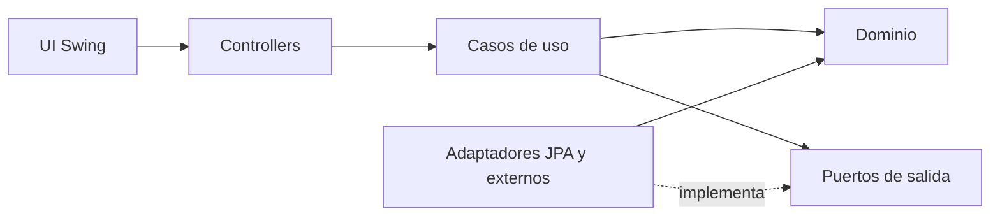

# Arquitectura inicial

Este documento describe la base de código generada para continuar el TPI. La
consigna PDF de la cátedra prevalece si difiere de esta interpretación.

## Estructura y regla de dependencias

```text
ar.edu.uade.skillswap
├── dominio/                 # Entidades y reglas Java puro
│   ├── publicaciones/
│   ├── contrataciones/
│   └── compartido/
├── aplicacion/              # Casos de uso y puertos propiedad del núcleo
│   ├── publicaciones/
│   ├── contrataciones/
│   └── puertos/
├── infraestructura/         # Próximo hito: JPA, Flyway y adaptadores externos
├── controllers/             # Contrato actual de la UI Swing
├── model/                   # Modelos de vista existentes
├── mock/                    # Implementación de demostración existente
└── ui/                      # Interfaz provista; no contiene reglas de negocio
```



La infraestructura es un detalle: la capa de dominio no importa JPA, Hibernate,
Swing, MySQL ni clases de `mock`. Los casos de uso dependen de interfaces
definidas por la aplicación. La configuración manual de objetos se agregará en
el punto de composición cuando se conecte la implementación persistente.

## Dominio implementado

- `Publicacion` crea borradores, agrega disponibilidad y rechaza transiciones
  inválidas. Publicar exige título, categoría y al menos una franja. Toda
  transición guarda fecha, actor y motivo en una lista inmutable.
- `PAUSADA → PUBLICADA` está permitido como interpretación del equipo. `CERRADA`
  y `CANCELADA` son estados terminales. Cancelar requiere motivo.
- `Contratacion` modela solicitud, aceptación/rechazo, pago, inicio,
  finalización y cancelación, valida quién puede ejecutar cada acción y conserva
  el historial.
- Los objetos de dominio no son entidades JPA ni DTOs de la UI.

Las políticas de reembolso, reputación, reprogramación, búsqueda, recomendaciones
y canales de notificación quedan para los siguientes casos de uso.

## Puertos y transacciones

`RepositorioPublicaciones`, `RepositorioContrataciones` y `UnidadDeTrabajo` son
puertos de salida. Los adaptadores deben implementarlos fuera de
`aplicacion/`. `AceptarContratacion` ejecuta la aceptación dentro de
`UnidadDeTrabajo` y delega al repositorio una operación atómica que rechaza la
reserva si se agotó el cupo. El primer modelo interpreta el cupo por franja
publicada; el equipo debe validar esa decisión con la cátedra. La implementación
JPA deberá protegerla ante aceptaciones concurrentes (por ejemplo, mediante
bloqueo optimista y error explícito); no debe implementarse como un simple
conteo seguido de un guardado.

## Patrones previstos

| Patrón | Variación que resuelve | Próxima evidencia |
|---|---|---|
| Máquina de estados | Las entidades validan transiciones con estados explícitos; aún no se usa el patrón GoF State | Tests de transiciones de dominio incluidos |
| Strategy | Algoritmo de recomendación y política de reintegro | Crear interfaces y tests por política |
| Adapter | Identidad, email/push y persistencia JPA | Implementar puertos en infraestructura |
| Observer | Un evento puede notificar a cliente y proveedor | Agregar publicador y suscriptores testeables |

Esta base todavía no acredita los cuatro patrones requeridos: deja identificadas
las variaciones para implementarlos y probarlos en los hitos siguientes. No se
introducen patrones sin una variación concreta. La UI mock actual sigue usando
sus contratos anteriores hasta que se complete la adaptación de controllers.

## Migraciones

`src/main/resources/db/migration/V1__esquema_inicial.sql` define el esquema
relacional previsto, claves foráneas, restricciones, índices y control de
versiones para publicaciones, contrataciones y wallets. Los datos se mantienen
en tablas relacionales normalizadas; las migraciones, no Hibernate, serán la
fuente de verdad del esquema. Las entidades/adaptadores JPA deben mapear estas
tablas y validar el esquema en vez de crearlo.

La migración todavía no se ejecuta automáticamente desde la UI: falta definir la
configuración de conexión local y el adaptador de arranque una vez que el equipo
prepare MySQL.
