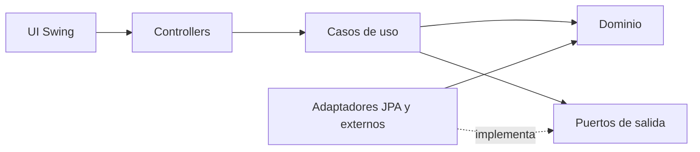

# Arquitectura inicial

Este documento describe la base de código generada para continuar el TPI. La
consigna PDF de la cátedra prevalece si difiere de esta interpretación.

## Estructura y regla de dependencias

```text
ar.edu.uade.skillswap
├── domain/                  # Entidades, value objects y reglas Java puro
│   ├── publicacion/         # Agregado Publicacion, franjas e ids
│   │   ├── state/           # Patrón State: EstadoPublicacion y sus estados
│   │   ├── decorator/       # Patrón Decorator: precio y promociones acumulables
│   │   └── exception/
│   ├── contratacion/        # Agregado Contratacion, solicitud, reintegro, reprogramación y calificaciones
│   │   ├── state/           # Patrón State: EstadoContratacion y sus estados
│   │   ├── strategy/        # Patrón Strategy: políticas de reintegro y su factory
│   │   ├── evento/          # Eventos de dominio que emite la contratación
│   │   └── exception/
│   ├── notificacion/        # Agregado Notificacion (bandeja) y su repositorio
│   │   └── exception/
│   ├── perfil/              # Agregado Perfil, reputación, disponibilidad semanal y su repositorio
│   │   └── exception/
│   ├── wallet/              # Agregado Wallet, movimientos, retención de pagos y su repositorio
│   │   └── exception/
│   └── shared/              # SkillCoins, Puntaje, CambioEstado, EventoDominio y excepciones base
├── application/             # Pendiente: casos de uso y puertos sobre el nuevo dominio
├── infrastructure/          # Próximo hito: JPA, Flyway y adaptadores externos
├── controllers/             # Contrato actual de la UI Swing
├── model/                   # Modelos de vista existentes
├── mock/                    # Implementación de demostración existente
└── ui/                      # Interfaz provista; no contiene reglas de negocio
```



La infraestructura es un detalle: la capa de dominio no importa JPA, Hibernate,
Swing, MySQL ni clases de `controllers`, `ui`, `mock` o `model`; `ArquitecturaTest`
lo verifica en cada build. Los módulos de dominio se referencian entre sí solo
por id (`PublicacionId`, `FranjaId` o el `userId` de las personas); la coordinación entre módulos corresponde a
la capa de aplicación. La configuración manual de objetos se agregará en
el punto de composición cuando se conecte la implementación persistente.

## Dominio implementado

- `Publicacion` se crea como borrador con autor y tipo (oferta o desafío). En
  `BORRADOR` se edita libremente y se agregan franjas de disponibilidad, que no
  pueden superponerse. Publicar exige título, categoría, precio, cupo de al menos
  1 y al menos una franja; si falta algo, la excepción lista todos los faltantes.
- Los estados de la publicación usan el patrón State (`domain/publicacion/state`):
  cada estado sabe qué acciones admite y el resto se rechaza con
  `TransicionInvalidaException`. `PAUSADA → PUBLICADA` (reanudar) está permitido
  como interpretación del equipo; `CERRADA` y `CANCELADA` son terminales y
  cancelar requiere motivo. Solo una publicación `PUBLICADA` admite solicitudes.
- El cupo es **por franja**: `reservarCupo(franjaId)` toma un lugar de esa franja
  y falla con `CupoAgotadoException` cuando se llena; `liberarCupo` lo devuelve.
  Lo controla el agregado `Publicacion`, no la contratación.
- Las **promociones** modifican el precio de la publicación sin producir nunca un
  total negativo (regla 6, caso de aceptación 9). El autor las agrega y las quita
  con `agregarPromocion` y `quitarPromocion` en `BORRADOR`, `PUBLICADA` y
  `PAUSADA` (`EstadoPublicacion.admitePromociones()`); en `CERRADA` o `CANCELADA`
  se rechazan con `TransicionInvalidaException`. Son acumulables, se pueden
  repetir y no cambian el estado ni el historial. Hay dos tipos:
  `DescuentoPorcentual` (1 a 100 %, el descuento se redondea hacia abajo) y
  `DescuentoFijo` (mayor a 0, con tope en 0). `precioFinal()` usa el patrón
  Decorator (`domain/publicacion/decorator`): envuelve `PrecioBase` con un
  `PrecioConPromocion` por promoción, en el orden en que se agregaron, porque el
  orden cambia el resultado (100 con 10 % y −20 da 70; con −20 y 10 %, 72).
  `precioBase()` sigue devolviendo el precio sin descuentos, y `Contratacion`
  sigue recibiendo el precio ya calculado.
- `Contratacion` también usa State (`domain/contratacion/state`): `PENDIENTE`,
  `ACEPTADA`, `CONFIRMADA`, `EN_CURSO`, `COMPLETADA`, `RECHAZADA` y `CANCELADA`.
  Valida el rol de quien actúa (el proveedor acepta, rechaza, inicia y completa;
  el cliente paga), rechaza la autosolicitud y, en `PENDIENTE`, solo deja
  cancelar al cliente (retira la solicitud).
- Al cancelar una contratación confirmada, el reintegro lo calcula una política
  del patrón Strategy (`domain/contratacion/strategy`): `ReintegroPorAnticipacion`
  devuelve 100 %, 50 % o 0 % según la anticipación (48 h y 24 h por defecto,
  configurables) y `ReintegroTotal` devuelve todo cuando cancela el proveedor.
  `PoliticaReintegroFactory` elige la política según quién cancela. Antes del
  pago el reintegro es cero.
- La reprogramación no cambia el estado: un participante propone otra franja en
  `ACEPTADA` o `CONFIRMADA`, antes del inicio, y el otro la acepta o la rechaza.
  Al aceptarla, la contratación devuelve la franja anterior para que se libere su
  cupo.
- Calificar es una acción de la `Contratacion`, no un agregado aparte: solo el
  estado `COMPLETADA` la admite (`admiteCalificacion()` del State), solo los
  participantes califican (un tercero recibe `AccionNoPermitidaException`) y
  cada uno lo hace una vez (`CalificacionDuplicadaException`). El destinatario se
  deduce como la otra parte, así que nadie puede calificarse a sí mismo. El
  puntaje (`Puntaje`, en `domain/shared`) va de 1 a 5 y el comentario es
  opcional. Calificar no cambia el estado ni agrega un cambio al historial.
- `Perfil` se identifica por el `userId` del servicio de identidad (un usuario
  tiene un solo perfil) y tiene un `TipoPerfil` fijo desde la creación:
  `PROFESIONAL` (publica ofertas) u `ORGANIZACION` (publica desafíos). Guarda
  nombre visible, biografía, zona horaria, habilidades, intereses, disponibilidad
  semanal (`DisponibilidadSemanal`: día y horario, sin superposiciones en el
  mismo día) y el canal de notificación preferido (`EMAIL`, `PUSH` o `INTERNA`,
  que es el valor inicial).
- La reputación (`Reputacion`) guarda la suma de puntajes y la cantidad de
  calificaciones, para filtrar y ordenar sin recorrerlas. No se edita: la única
  forma de cambiarla es `Perfil.registrarCalificacion(puntaje)` con el puntaje de
  una calificación que ya validó la contratación. El caso de uso de calificar
  hará las dos cosas en una transacción. Sin calificaciones, el promedio es 0 y
  `cantidad()` distingue ese caso.
- La baja del perfil es lógica (regla 9): `darDeBaja` exige motivo, queda en el
  historial (`ACTIVO → INACTIVO`) con fecha y actor, y una segunda baja se
  rechaza. Un perfil dado de baja no se edita (`PerfilInactivoException`), pero
  sigue recibiendo calificaciones de contrataciones anteriores.
- `PerfilRepository` (`findByUserId`, `save`) es el puerto de persistencia del
  perfil y vive en la raíz del módulo.
- Toda transición válida guarda estado de origen y destino, fecha, actor y motivo
  en un historial que solo crece y se expone como lista inmodificable. Una
  operación rechazada no modifica nada.
- Las operaciones de `Contratacion` que le interesan a otra parte registran un
  evento de dominio (`EventoDominio`, en `domain/shared`) después de validarse,
  en el mismo punto donde se registra el cambio de estado. Una operación
  rechazada no agrega eventos. `extraerEventos()` devuelve los pendientes en
  orden, como lista inmodificable, y vacía la lista; el caso de uso lo llamará
  una vez, después de guardar.
- Cada evento declara a quién le interesa, así la regla "a quién se notifica"
  vive en el dominio:

  | Evento | Lo emite | Interesados |
  |---|---|---|
  | `SolicitudRecibida` | `solicitar` | Proveedor |
  | `ContratacionAceptada` | `aceptar` | Cliente |
  | `PagoConfirmado` | `pagar` | Proveedor |
  | `ReprogramacionPropuesta` | `proponerReprogramacion` | La contraparte de quien propone |
  | `ReprogramacionAceptada` | `aceptarReprogramacion` | Quien propuso |
  | `ContratacionCancelada` | `cancelar` (con motivo) | La contraparte de quien cancela |
  | `SesionCompletada` | `completar` | Cliente y proveedor |

  `rechazar`, `iniciar` y `rechazarReprogramacion` no emiten eventos porque la
  consigna no los pide.
- `Notificacion` (`domain/notificacion`) es un aviso genérico en la bandeja de un
  usuario: se crea con `Notificacion.para(destinatarioId, evento)` a partir de
  cualquier `EventoDominio`, copia tipo, título, detalle y fecha, y arranca sin
  leer. El destinatario tiene que estar entre los interesados del evento. Solo
  el destinatario puede marcarla como leída (`NotificacionAjenaException`) y
  marcarla dos veces no cambia nada. No conoce `Contratacion`: depende solo de
  `domain/shared`, y `ArquitecturaTest` lo verifica. El canal (interna, email o
  push) no es parte de la notificación; se resolverá en aplicación según el
  perfil.
- Los objetos de dominio no son entidades JPA ni DTOs de la UI.

### Wallet

- `Wallet` se identifica por el `userId` del titular, igual que `Contratacion`.
  Se abre con un bono de bienvenida (el monto lo decide el punto de composición,
  no el dominio) que queda registrado como `ACREDITACION_DEMO`;
  `acreditarDemo` permite cargar más saldo de demostración.
- El saldo nunca es negativo (regla 4): `debitar` más de lo que hay lanza
  `SaldoInsuficienteException` sin modificar nada. `acreditar` y `reintegrar`
  suman al saldo. Los importes deben ser mayores que 0.
- Cada operación crea un `Movimiento` inmutable con su tipo (`CREDITO`, `DEBITO`,
  `REINTEGRO`, `ACREDITACION_DEMO`, los mismos del esquema), importe, saldo
  resultante, concepto, contratación y fecha. La Wallet guarda el saldo y solo
  los movimientos nuevos; el historial completo y paginado lo listará el
  repositorio (`WalletRepository`).
- **Retención del pago.** Lo pagado no va directo al proveedor: queda retenido en
  una Wallet de garantía de la plataforma hasta que la contratación se completa.
  El servicio de dominio `RetencionDePagos` agrupa cada débito con su crédito para
  que no puedan separarse: `retener` (cliente → garantía, al pagar),
  `liberarAlProveedor` (garantía → proveedor, al completar) y `repartir`
  (garantía → cliente y proveedor según el `Reintegro`, al cancelar después del
  pago; un monto 0 no genera movimiento y el reparto tiene que sumar el total
  retenido). Siempre debita primero, así que si el débito falla ninguna Wallet
  cambia, y la suma de los saldos se conserva.
- `wallet` conoce a `contratacion` solo por `ContratacionId`. Coordinar la
  transición de la contratación con el movimiento de fondos, y guardarlos en una
  misma transacción, es tarea del caso de uso. El doble cobro lo impide el estado
  de `Contratacion` (solo se paga desde `ACEPTADA`) y, en persistencia, la
  restricción única `(contratacion_id, wallet_perfil_id, tipo)`.
- Wallet no tiene estados ni variaciones, así que no introduce un patrón nuevo.

Búsqueda, recomendaciones, el publicador de eventos, el envío de notificaciones
por el canal elegido y el perfil público quedan para los siguientes hitos. La
validación de que el tipo de perfil coincida con el tipo de publicación cruza
dos módulos y la hará el caso de uso de publicar.

## Casos de uso y puertos

La capa de aplicación (casos de uso, puertos de repositorio y unidad de trabajo)
está pendiente de reconstruirse sobre este dominio. La primera versión se escribió
sobre un modelo anterior y se eliminó al unificar el dominio. Al reconstruirla,
los puertos de repositorio de cada agregado irán en la raíz de su módulo de
dominio, y la concurrencia sobre el cupo se resolverá en persistencia con bloqueo
optimista sobre la publicación, no con un conteo seguido de un guardado.

## Patrones previstos

| Patrón | Variación que resuelve | Evidencia |
|---|---|---|
| State | Qué acciones admite cada estado de publicación y de contratación | `EstadoPublicacionTest`, `EstadoContratacionTest` y tests de los agregados |
| Strategy | Política de reintegro según quién cancela y con cuánta anticipación; más adelante, recomendaciones | `PoliticaReintegroTest`, `PoliticaReintegroFactoryTest` |
| Decorator | Promociones acumulables sobre el precio de una publicación: cada una modifica el resultado de la anterior, y un tipo nuevo es una clase nueva | `PromocionTest`, `PrecioTest` y `PublicacionTest.Promociones` |
| Adapter | Identidad, email/push y persistencia JPA | Pendiente: implementar puertos en infraestructura |
| Observer | Un evento puede notificar a cliente y proveedor | Dominio listo, falta el publicador: eventos e interesados en `ContratacionTest` y `EventosContratacionTest`, bandeja en `NotificacionTest` |

State, Strategy y Decorator ya están implementados y cubiertos por tests. De
Observer está listo el dominio (eventos con sus interesados y la notificación);
el publicador y los suscriptores van en la capa de aplicación. Adapter queda
para los hitos siguientes. No se
introducen patrones sin una variación concreta. La UI mock actual sigue usando
sus contratos anteriores hasta que se complete la adaptación de controllers.

## Migraciones

`src/main/resources/db/migration/V1__esquema_inicial.sql` define el esquema
relacional previsto, claves foráneas, restricciones, índices y control de
versiones para publicaciones, contrataciones y wallets. Los datos se mantienen
en tablas relacionales normalizadas; las migraciones, no Hibernate, serán la
fuente de verdad del esquema. Las entidades/adaptadores JPA deben mapear estas
tablas y validar el esquema en vez de crearlo.

La migración todavía no se ejecuta automáticamente desde la UI: falta definir la
configuración de conexión local y el adaptador de arranque una vez que el equipo
prepare MySQL.
