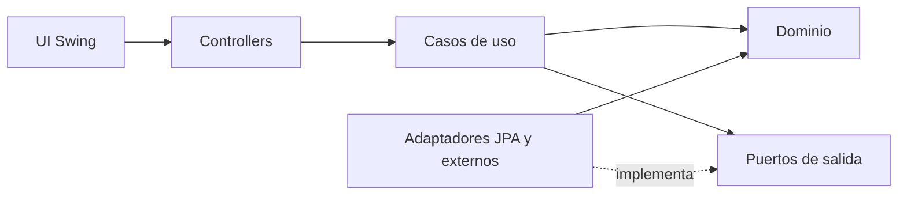

# Arquitectura inicial

Este documento describe la base de código generada para continuar el TPI. La
consigna PDF de la cátedra prevalece si difiere de esta interpretación.

## Estructura y regla de dependencias

```text
ar.edu.uade.skillswap
├── domain/                  # Entidades, value objects y reglas Java puro
│   ├── publicacion/         # Agregado Publicacion, franjas e ids
│   │   ├── state/           # Patrón State: EstadoPublicacion y sus estados
│   │   └── exception/
│   ├── contratacion/        # Agregado Contratacion, solicitud, reintegro y reprogramación
│   │   ├── state/           # Patrón State: EstadoContratacion y sus estados
│   │   ├── strategy/        # Patrón Strategy: políticas de reintegro y su factory
│   │   └── exception/
│   └── shared/              # SkillCoins, CambioEstado y excepciones base
├── application/             # Pendiente: casos de uso y puertos sobre el nuevo dominio
├── infrastructure/          # Próximo hito: JPA, Flyway y adaptadores externos
├── controllers/             # Contrato actual de la UI Swing
├── model/                   # Modelos de vista existentes
├── mock/                    # Implementación de demostración existente
└── ui/                      # Interfaz provista; no contiene reglas de negocio
```



La infraestructura es un detalle: la capa de dominio no importa JPA, Hibernate,
Swing, MySQL ni clases de `controllers`, `ui`, `mock` o `model`; `ArquitecturaTest`
lo verifica en cada build. Los módulos de dominio se referencian entre sí solo
por id (`PublicacionId`, `FranjaId`); la coordinación entre módulos corresponde a
la capa de aplicación. La configuración manual de objetos se agregará en
el punto de composición cuando se conecte la implementación persistente.

## Dominio implementado

- `Publicacion` se crea como borrador con autor y tipo (oferta o desafío). En
  `BORRADOR` se edita libremente y se agregan franjas de disponibilidad, que no
  pueden superponerse. Publicar exige título, categoría, precio, cupo de al menos
  1 y al menos una franja; si falta algo, la excepción lista todos los faltantes.
- Los estados de la publicación usan el patrón State (`domain/publicacion/state`):
  cada estado sabe qué acciones admite y el resto se rechaza con
  `TransicionInvalidaException`. `PAUSADA → PUBLICADA` (reanudar) está permitido
  como interpretación del equipo; `CERRADA` y `CANCELADA` son terminales y
  cancelar requiere motivo. Solo una publicación `PUBLICADA` admite solicitudes.
- El cupo es **por franja**: `reservarCupo(franjaId)` toma un lugar de esa franja
  y falla con `CupoAgotadoException` cuando se llena; `liberarCupo` lo devuelve.
  Lo controla el agregado `Publicacion`, no la contratación.
- `Contratacion` también usa State (`domain/contratacion/state`): `PENDIENTE`,
  `ACEPTADA`, `CONFIRMADA`, `EN_CURSO`, `COMPLETADA`, `RECHAZADA` y `CANCELADA`.
  Valida el rol de quien actúa (el proveedor acepta, rechaza, inicia y completa;
  el cliente paga), rechaza la autosolicitud y, en `PENDIENTE`, solo deja
  cancelar al cliente (retira la solicitud).
- Al cancelar una contratación confirmada, el reintegro lo calcula una política
  del patrón Strategy (`domain/contratacion/strategy`): `ReintegroPorAnticipacion`
  devuelve 100 %, 50 % o 0 % según la anticipación (48 h y 24 h por defecto,
  configurables) y `ReintegroTotal` devuelve todo cuando cancela el proveedor.
  `PoliticaReintegroFactory` elige la política según quién cancela. Antes del
  pago el reintegro es cero.
- La reprogramación no cambia el estado: un participante propone otra franja en
  `ACEPTADA` o `CONFIRMADA`, antes del inicio, y el otro la acepta o la rechaza.
  Al aceptarla, la contratación devuelve la franja anterior para que se libere su
  cupo.
- Toda transición válida guarda estado de origen y destino, fecha, actor y motivo
  en un historial que solo crece y se expone como lista inmodificable. Una
  operación rechazada no modifica nada.
- Los objetos de dominio no son entidades JPA ni DTOs de la UI.

Reputación, búsqueda, recomendaciones y canales de notificación quedan para los
siguientes hitos.

## Casos de uso y puertos

La capa de aplicación (casos de uso, puertos de repositorio y unidad de trabajo)
está pendiente de reconstruirse sobre este dominio. La primera versión se escribió
sobre un modelo anterior y se eliminó al unificar el dominio. Al reconstruirla,
los puertos de repositorio de cada agregado irán en la raíz de su módulo de
dominio, y la concurrencia sobre el cupo se resolverá en persistencia con bloqueo
optimista sobre la publicación, no con un conteo seguido de un guardado.

## Patrones previstos

| Patrón | Variación que resuelve | Evidencia |
|---|---|---|
| State | Qué acciones admite cada estado de publicación y de contratación | `EstadoPublicacionTest`, `EstadoContratacionTest` y tests de los agregados |
| Strategy | Política de reintegro según quién cancela y con cuánta anticipación; más adelante, recomendaciones | `PoliticaReintegroTest`, `PoliticaReintegroFactoryTest` |
| Adapter | Identidad, email/push y persistencia JPA | Pendiente: implementar puertos en infraestructura |
| Observer | Un evento puede notificar a cliente y proveedor | Pendiente: publicador y suscriptores testeables |

State y Strategy ya están implementados y cubiertos por tests; Adapter y
Observer quedan para los hitos siguientes. No se
introducen patrones sin una variación concreta. La UI mock actual sigue usando
sus contratos anteriores hasta que se complete la adaptación de controllers.

## Migraciones

`src/main/resources/db/migration/V1__esquema_inicial.sql` define el esquema
relacional previsto, claves foráneas, restricciones, índices y control de
versiones para publicaciones, contrataciones y wallets. Los datos se mantienen
en tablas relacionales normalizadas; las migraciones, no Hibernate, serán la
fuente de verdad del esquema. Las entidades/adaptadores JPA deben mapear estas
tablas y validar el esquema en vez de crearlo.

La migración todavía no se ejecuta automáticamente desde la UI: falta definir la
configuración de conexión local y el adaptador de arranque una vez que el equipo
prepare MySQL.
