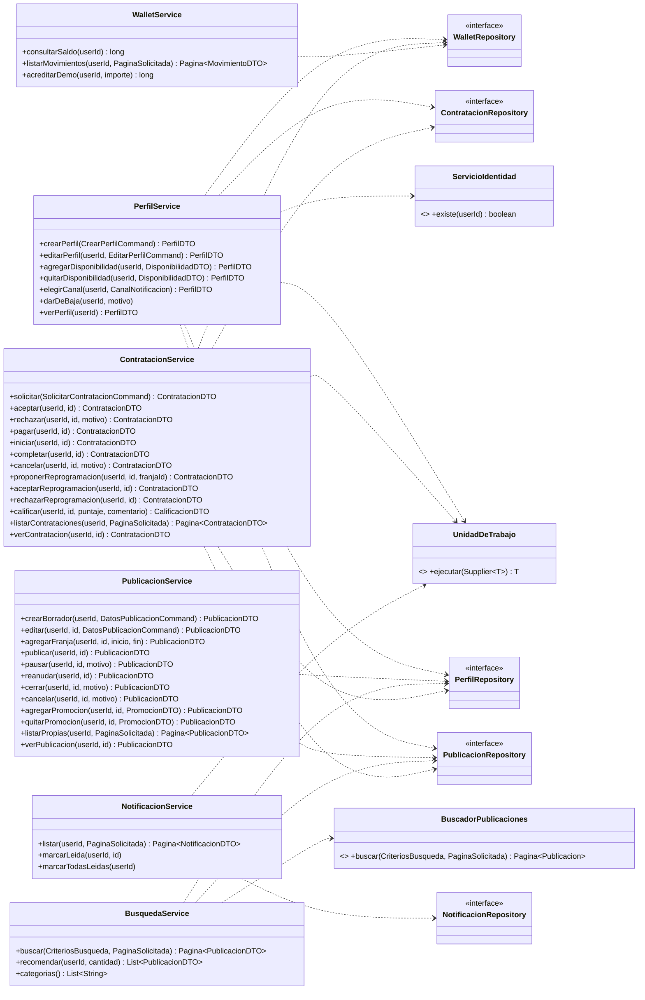
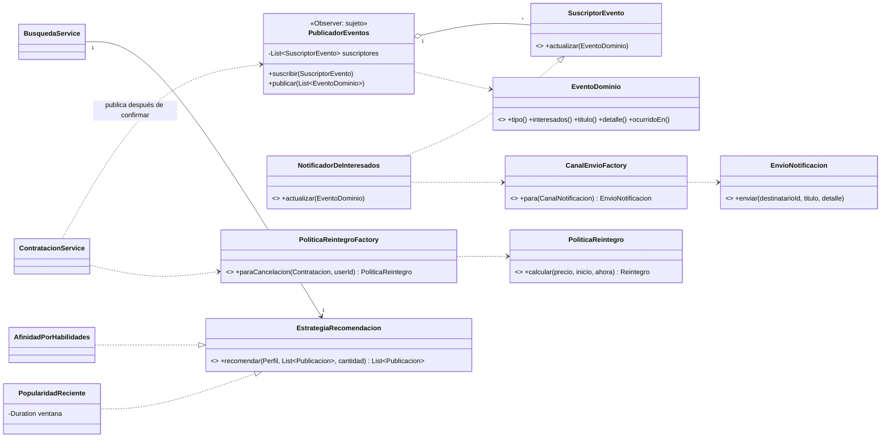
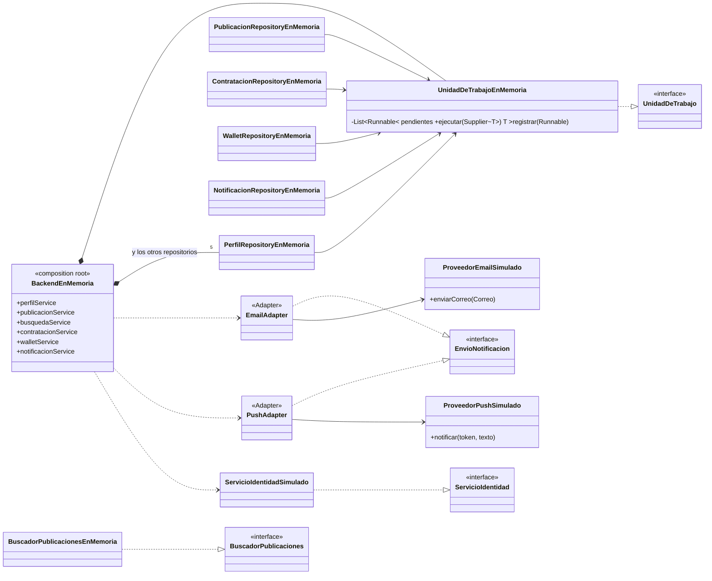
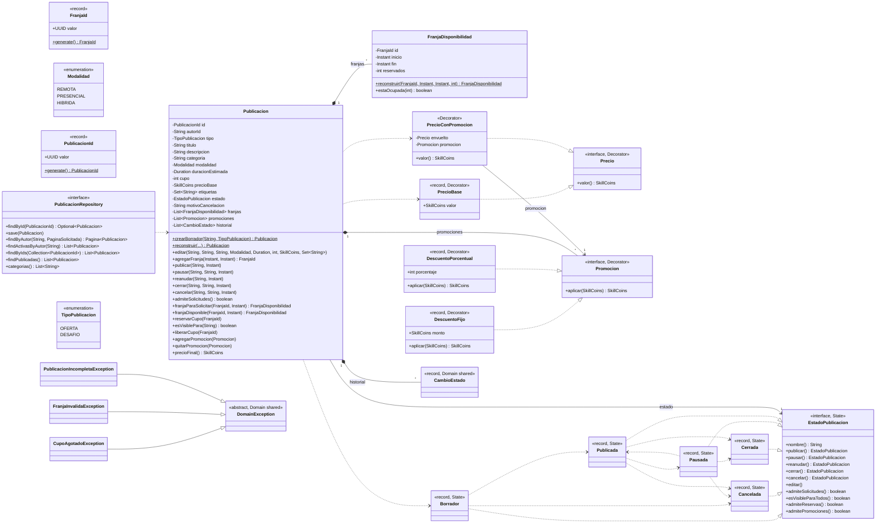
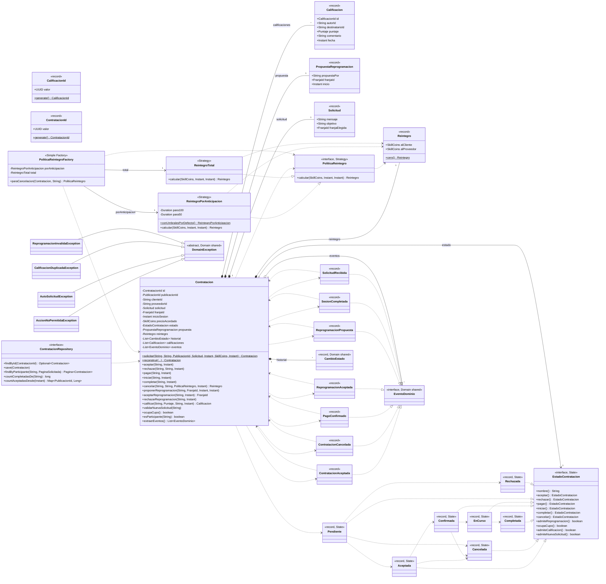
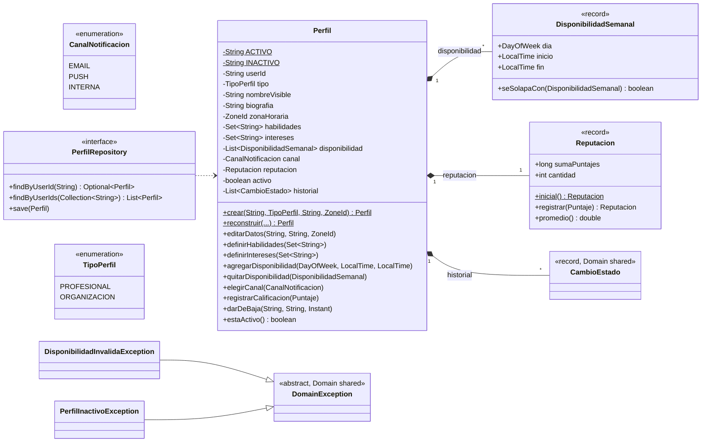
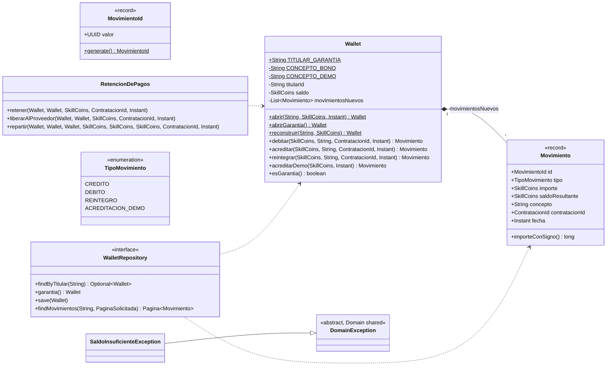
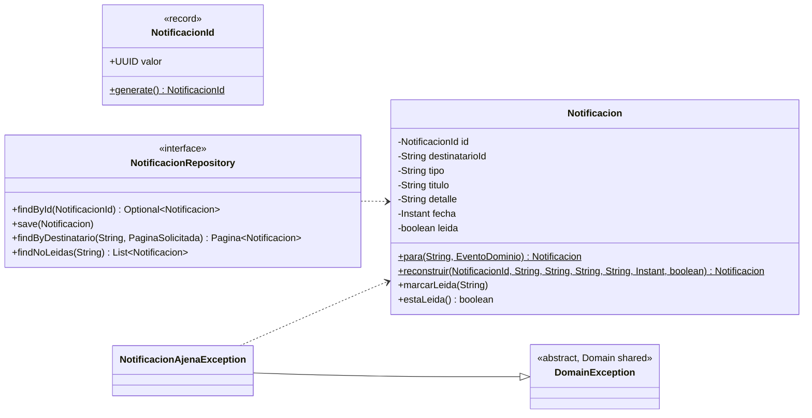
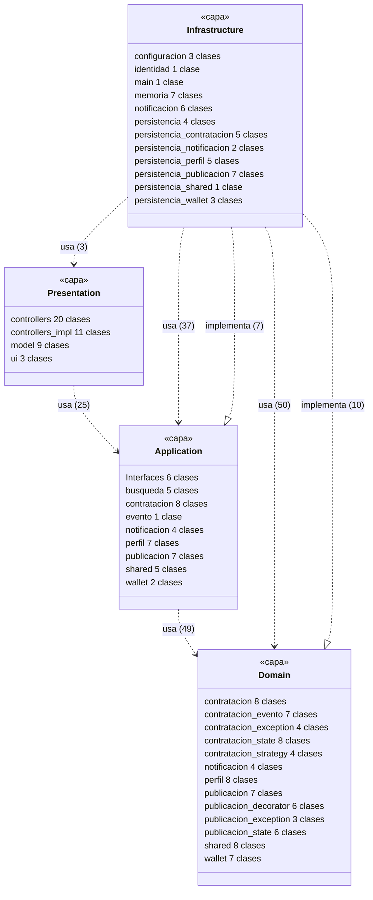

# Diagramas de clases: capa de aplicación e infraestructura

Diagramas de clases hechos desde el código real (dominio y aplicación, con relaciones,
multiplicidades y patrones identificados). Hay tres formatos:

- **PlantUML:** [`diagrama-clases.puml`](diagrama-clases.puml) y su PNG (vista general) y uno por módulo
  en [`diagramas/`](diagramas/) (publicacion, contratacion, perfil, wallet, notificacion, busqueda, shared).
- **StarUML:** [`SkillSwap.mdj`](SkillSwap.mdj), con el modelo completo y 9 diagramas (paquetes,
  "Dominio y aplicación" y uno por módulo). La disposición de las cajas es en grilla y conviene
  ordenarla al abrirlo.
- **Mermaid:** este archivo. Las secciones 1 a 4 muestran la capa de aplicación (por partes, para que
  se pueda leer) y cómo la implementa la infraestructura; la 5, cada agregado del dominio, y la 6, las
  dependencias entre capas.

Todo se generó con un script del equipo que lee las fuentes Java; el PNG se renderizó con PlantUML
(layout smetana) y el `.mdj` se validó estructuralmente (JSON, ids únicos, sin `$ref` rotos).

Convenciones: `..>` depende de (usa), `..|>` implementa, `--|>` hereda, `*--` compone, `o--` agrega, `-->` tiene una referencia (campo).
Los estereotipos marcan el patrón: `<<Observer>>`, `<<Strategy>>`, `<<SimpleFactory>>`, `<<Adapter>>`.

## 1. Services y puertos

## 2. Patrones en la capa de aplicación

## 3. Infraestructura: implementaciones de los puertos

Los repositorios en memoria implementan los puertos del dominio: `PerfilRepositoryEnMemoria ..|> PerfilRepository`, y lo mismo con publicación, contratación, wallet y notificación.

## 4. DTOs y excepciones de aplicación

Entrada (commands): `CrearPerfilCommand`, `EditarPerfilCommand`, `DatosPublicacionCommand`,
`SolicitarContratacionCommand` y `CriteriosBusqueda` (con `OrdenBusqueda`). Salida, además de las
de arriba: `MovimientoDTO` y `NotificacionDTO`.

<!-- generado:inicio (herramientas/diagramas/generar.py) -->

## 5. Agregados del dominio

Generados desde `src/main/java/.../domain`. Cada agregado muestra atributos y operaciones públicas (sin los accesores triviales `x()`), las partes que compone y las clases de otros módulos con las que tiene una relación estructural (sin miembros, con el módulo como estereotipo). Los estados concretos, los eventos y las excepciones se dibujan sin miembros: repiten la interfaz o la superclase. Los ids (`PerfilId`, `PublicacionId`, ...) se ven como dependencia hacia el agregado que identifican.

### 5.1 Publicación

22 clases en `domain.publicacion`, 29 relaciones.

### 5.2 Contratación

31 clases en `domain.contratacion`, 59 relaciones.

### 5.3 Perfil

8 clases en `domain.perfil`, 6 relaciones.

### 5.4 Wallet

7 clases en `domain.wallet`, 5 relaciones.

### 5.5 Notificación

4 clases en `domain.notificacion`, 3 relaciones.

## 6. Capas y flujo de dependencias

Cantidad de relaciones del código (campos, parámetros, retornos, `new`, `throw`, herencia) que cruzan de una capa a otra. `implementa` cuenta clases que realizan una interfaz de la otra capa (los puertos).

El dominio no depende de ninguna otra capa y Application solo depende de Domain: las flechas apuntan hacia adentro (Presentation → Application → Domain; Infrastructure implementa los puertos de Application y Domain).

Infrastructure → Presentation: SkillSwapApplication usa SkillSwapControllers, SkillSwapView, Theme. Es la raíz de composición: arma la aplicación y por eso conoce la UI.

<!-- generado:fin -->
