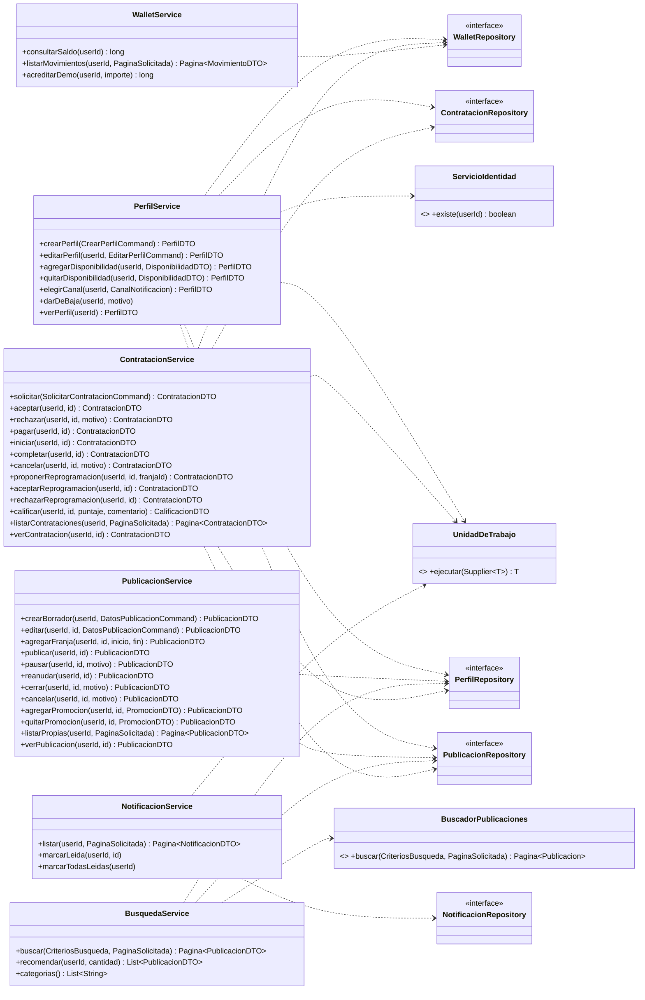

# Diagramas de clases: capa de aplicación e infraestructura

Base para el diagrama de StarUML que pide la entrega ("dominio y aplicación, con relaciones,
multiplicidades y patrones identificados"). Los diagramas de cada agregado del dominio están en
las descripciones de los PRs #4 a #11 y #13. Acá están la capa de aplicación (por partes, para que
se pueda leer) y cómo la implementa la infraestructura.

Convenciones: `..>` depende de (usa), `..|>` implementa, `*--` compone, `o--` agrega.
Los estereotipos marcan el patrón: `<<Observer>>`, `<<Strategy>>`, `<<SimpleFactory>>`, `<<Adapter>>`.

## 1. Services y puertos

## 2. Patrones en la capa de aplicación

## 3. Infraestructura: implementaciones de los puertos

Los repositorios en memoria implementan los puertos del dominio: `PerfilRepositoryEnMemoria ..|> PerfilRepository`, y lo mismo con publicación, contratación, wallet y notificación.

## 4. DTOs y excepciones de aplicación

```mermaid
classDiagram
    class ApplicationException { <<abstract>> }
    class RecursoNoEncontradoException
    class PermisoDenegadoException
    class PerfilDuplicadoException
    RecursoNoEncontradoException --|> ApplicationException
    PermisoDenegadoException --|> ApplicationException
    PerfilDuplicadoException --|> ApplicationException

    class ContratacionDTO { <<record>> id, publicacionId, tituloPublicacion, clienteId, proveedorId, franjaId, inicioSesion, precioAcordado, estado }
    class CambioEstadoDTO { <<record>> desde, hacia, fecha, actorId, motivo }
    class CalificacionDTO { <<record>> autorId, destinatarioId, puntaje, comentario, fecha }
    class ReintegroDTO { <<record>> alCliente, alProveedor }
    class PropuestaReprogramacionDTO { <<record>> propuestaPor, franjaId, inicio }
    ContratacionDTO "1" *-- "*" CambioEstadoDTO : historial
    ContratacionDTO "1" *-- "*" CalificacionDTO : calificaciones
    ContratacionDTO "1" *-- "0..1" ReintegroDTO
    ContratacionDTO "1" *-- "0..1" PropuestaReprogramacionDTO

    class PublicacionDTO { <<record>> id, autorId, autorNombre, reputacionAutor, tipo, titulo, categoria, modalidad, precioBase, precioFinal, estado }
    class FranjaDTO { <<record>> id, inicio, fin, lugaresLibres }
    class PromocionDTO { <<record>> tipo, valor }
    PublicacionDTO "1" *-- "*" FranjaDTO
    PublicacionDTO "1" *-- "*" PromocionDTO

    class PerfilDTO { <<record>> userId, tipo, nombreVisible, canal, reputacion, cantidadCalificaciones, contratacionesCompletadas, activo }
    class DisponibilidadDTO { <<record>> dia, inicio, fin }
    PerfilDTO "1" *-- "*" DisponibilidadDTO
    PerfilDTO "1" *-- "*" PublicacionDTO : publicacionesActivas
```

Entrada (commands): `CrearPerfilCommand`, `EditarPerfilCommand`, `DatosPublicacionCommand`,
`SolicitarContratacionCommand` y `CriteriosBusqueda` (con `OrdenBusqueda`). Salida, además de las
de arriba: `MovimientoDTO` y `NotificacionDTO`.
