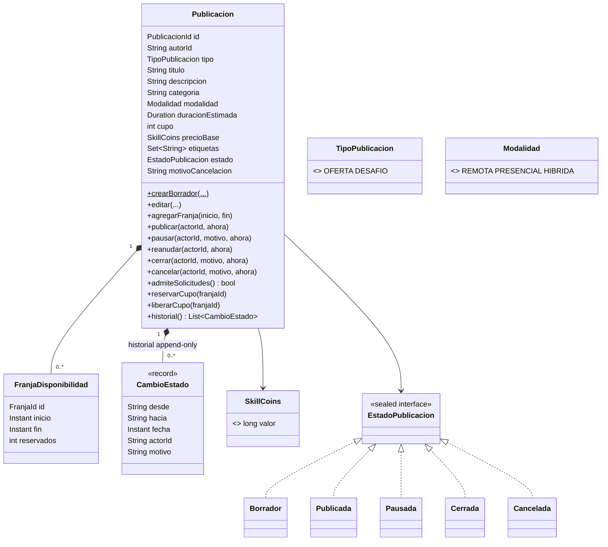
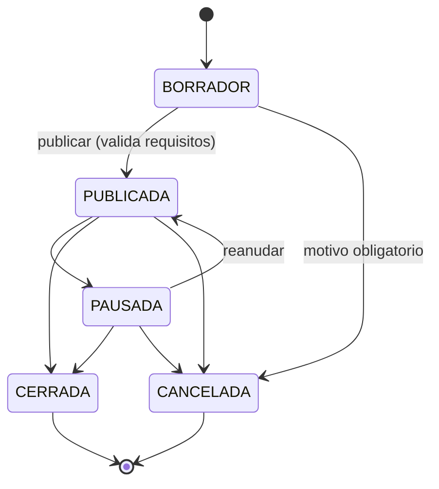

# Diseño de la entidad `Publicacion`

Fecha: 2026-11-11. Alcance: modelo de dominio del agregado `Publicacion` (Java puro), su puerto de repositorio y lo que la persistencia tiene que garantizar. No incluye controllers, búsqueda ni recomendación.

## Decisiones

| # | Decisión | Estado | Fuente |
|---|---|---|---|
| D1 | Estados de la publicación con **patrón State** (una clase por estado, interfaz sellada). Cuenta como uno de los 4 patrones. | Aprobada | Usuario, conversación 2026-11-11 |
| D2 | `PAUSADA → PUBLICADA` permitida mediante `reanudar`. Se documenta en el informe como interpretación del equipo. | Aprobada | Usuario, conversación 2026-11-11 |
| D3 | **Cupo por franja**: cada franja admite hasta `cupo` reservas. Una franja está "ocupada" cuando `reservados == cupo`. | Aprobada | Usuario, conversación 2026-11-11 |
| D4 | `TipoPublicacion { OFERTA, DESAFIO }` como enum, sin subclases. El caso de uso valida que solo un profesional cree ofertas y solo una organización cree desafíos. | Aprobada | Usuario, conversación 2026-11-11 |
| D5 | `Modalidad` del dominio incluye `REMOTA`, `PRESENCIAL` e `HIBRIDA`. Se documenta como extensión de la consigna (la consigna solo nombra remota y presencial). | Aprobada | Usuario, conversación 2026-11-11 |
| D6a | **Cerrar** siempre se permite. Las contrataciones `ACEPTADA`, `CONFIRMADA` y `EN_CURSO` siguen su curso; las `PENDIENTE` se rechazan automáticamente con motivo "publicación cerrada". | Aprobada | Usuario, conversación 2026-11-11 |
| D6b | **Cancelar** (opción mixta): se bloquea si hay contrataciones `ACEPTADA`, `CONFIRMADA` o `EN_CURSO`; las `PENDIENTE` se rechazan automáticamente. La cancelación de la publicación nunca mueve SkillCoins. | Aprobada | Usuario, conversación 2026-11-11 |

## Qué hay que preservar

- `Models.Publicacion` y `Models.EstadoPublicacion` son **modelos de vista** ([Models.java](../../src/main/java/ar/edu/uade/skillswap/model/Models.java)). El dominio tiene sus propios tipos; el controller traduce.
- Contrato actual de la UI: `PublicacionController.crearBorrador(...)` y `cambiarEstado(...)` ([UiControllers.java](../../src/main/java/ar/edu/uade/skillswap/controllers/UiControllers.java)). La app tiene que seguir abriendo con `mvn exec:java`.
- Reglas de la consigna: [02-alcance-funcional.md](../consigna/02-alcance-funcional.md) (estados, requisitos para publicar) y [03-reglas-de-negocio.md](../consigna/03-reglas-de-negocio.md) (reglas 2, 3 y 8).

## Estructura objetivo

Paquete: `ar.edu.uade.skillswap.dominio.publicacion`. Sin JPA, sin Swing.

### Máquina de estados (D1, D2)

`EstadoPublicacion` declara `publicar`, `pausar`, `reanudar`, `cerrar`, `cancelar`, `editar`, `admiteSolicitudes` y `nombre`. Por defecto cada acción lanza `TransicionInvalidaException`; cada estado concreto sobrescribe solo lo que permite. `Publicacion` delega en su estado y registra el `CambioEstado`.

### Invariantes

- `crearBorrador` exige `autorId` y `tipo`; el resto puede estar incompleto.
- `editar` y `agregarFranja` solo en `BORRADOR`.
- `publicar` exige título no vacío, categoría, precio ≥ 0, cupo ≥ 1 y al menos una franja. Si falla, la excepción lista todos los faltantes.
- `cancelar` exige motivo no vacío.
- `CERRADA` y `CANCELADA` son finales.
- Toda transición válida agrega un `CambioEstado` (fecha, actor, motivo). El historial se expone con `List.copyOf` y nunca se modifica ni se borra. Una transición rechazada no deja registro.
- `admiteSolicitudes()` es verdadero solo en `PUBLICADA` (regla 2).
- Franjas: `inicio < fin` y sin solapamiento dentro de la misma publicación.
- `reservarCupo(franjaId)` falla si la publicación no está `PUBLICADA` o si la franja tiene `reservados == cupo` (D3, regla 3). `liberarCupo` decrementa sin bajar de 0.
- `SkillCoins` rechaza valores negativos.
- Las operaciones reciben `ahora` y `actorId` como parámetros (tests deterministas).

Fuera de la entidad: reputación, nombre del proveedor y `destacada` (se arman en la consulta para la vista); precio final con promociones (Decorator, otro diseño); permiso del autor (`userId == autorId`, lo valida el caso de uso).

### Persistencia

- Puerto `PublicacionRepository` en el dominio; implementación JPA en infraestructura, con entidades JPA separadas y un mapper.
- Tablas: `publicacion`, `franja_disponibilidad`, `publicacion_etiqueta`, `publicacion_cambio_estado` (solo inserts). Migración Flyway.
- El estado se guarda como `nombre()`; el mapper reconstruye el estado concreto.
- Concurrencia de cupo: la aceptación modifica `reservados` de una franja (entidad hija). Hay que garantizar que dos aceptaciones simultáneas no tomen el último lugar: `@Version` en la franja, o `@Version` en `publicacion` cargada con `OPTIMISTIC_FORCE_INCREMENT`. Elige el desarrollador; el test de concurrencia es obligatorio.

### Cerrar y cancelar con contrataciones activas (D6)

La entidad `Publicacion` no conoce las contrataciones. La coordinación va en los casos de uso `CerrarPublicacion` y `CancelarPublicacion`, dentro de una única transacción:

1. Validar que el actor sea el autor.
2. `ContratacionRepository.buscarActivasPorPublicacion(publicacionId)`.
3. Solo en cancelar: si alguna está `ACEPTADA`, `CONFIRMADA` o `EN_CURSO`, lanzar `PublicacionConContratacionesActivasException` (con la cantidad) y no cambiar nada.
4. Rechazar cada `PENDIENTE` con motivo "publicación cerrada" o "publicación cancelada" (queda en el historial de la contratación y dispara la notificación).
5. `publicacion.cerrar(...)` o `publicacion.cancelar(...)` y guardar.

Motivo de D6b: el dinero solo se mueve en la cancelación de cada contratación (regla 5), así que la lógica de reembolso no se duplica. Costo aceptado: con clientes comprometidos, el proveedor cancela primero cada contratación y después la publicación.

## Pasos

1. Value objects y enums: `PublicacionId`, `FranjaId`, `SkillCoins`, `TipoPublicacion`, `Modalidad`. Tests unitarios.
2. `EstadoPublicacion` (interfaz sellada) y los cinco estados. Tests por estado × acción.
3. `FranjaDisponibilidad` y `Publicacion` con invariantes e historial. Tests unitarios.
4. Puerto `PublicacionRepository` y caso de uso de crear borrador / cambiar estado; conectar `PublicacionController` real manteniendo el mock compilando.
5. Infraestructura JPA, migración Flyway y test de concurrencia de cupo.

Cada paso deja `mvn test` en verde y la app abriendo.

## Verificación (aceptación)

- Publicar una oferta completa pasa a `PUBLICADA` y deja un `CambioEstado` con actor y fecha.
- Publicar sin franjas, sin título, sin categoría o con precio negativo falla y lista los faltantes (caso de aceptación 2).
- Cada transición no listada en el diagrama lanza `TransicionInvalidaException` y no modifica el historial; en particular, `CERRADA → PUBLICADA` y `CANCELADA → *`.
- `PAUSADA → PUBLICADA` funciona (D2).
- Cancelar sin motivo falla.
- `admiteSolicitudes()` es falso en todo estado salvo `PUBLICADA`.
- `reservarCupo` sobre una franja con `cupo = 1` y `reservados = 1` falla; otra franja de la misma publicación sigue aceptando (D3).
- Dos aceptaciones concurrentes sobre el último lugar: una sola se confirma (caso de aceptación 4).
- El historial devuelto no se puede modificar.
- Cerrar con una `CONFIRMADA` y una `PENDIENTE`: la publicación pasa a `CERRADA`, la `CONFIRMADA` sigue igual y la `PENDIENTE` queda `RECHAZADA` (D6a).
- Cancelar con una `CONFIRMADA`: falla, la publicación sigue en su estado y no se rechaza ninguna `PENDIENTE` (D6b, todo o nada).
- Cancelar con solo `PENDIENTE`: la publicación pasa a `CANCELADA`, las solicitudes quedan `RECHAZADA` y ningún saldo cambia (D6b).
- Una `Publicacion` con `HIBRIDA` se guarda y se recupera igual (D5).
- Ninguna clase de `dominio.publicacion` importa `jakarta.persistence` ni `javax.swing`.

## Preguntas abiertas

- Los casos de uso de D6 dependen de que existan `Contratacion` y `ContratacionRepository`. Hasta entonces, se implementan solo las transiciones de la entidad.
- Si `categoria` pasa a ser un catálogo jerárquico (Composite), `String categoria` se reemplaza por `CategoriaId`. Hoy queda como `String`.
- El desarrollador puede elegir solo: nombres de excepciones, tipo de los ids (UUID o String), y dónde va `@Version` (ver Persistencia).
